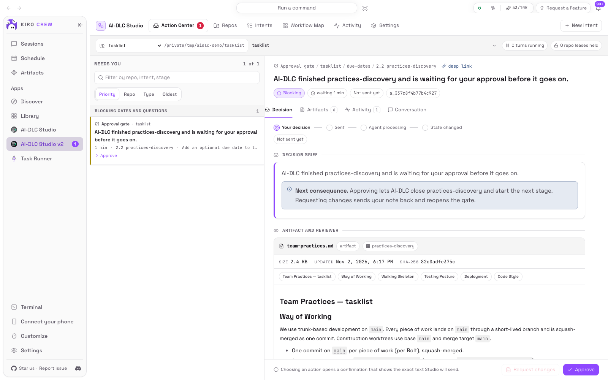

# AI-DLC Studio

**English** | [简体中文](README.zh-CN.md)

The control room for [AI-DLC Workflows](https://github.com/awslabs/aidlc-workflows) inside KiroCrew.
Everything AI-DLC is waiting on you for sits in one queue, across all of your repositories, with the
evidence beside it. Your decision goes back to AI-DLC as your own words, through its own conversation,
never around it.



> **This is the v2 branch (2.0.0 beta).** Same features as 1.x on a backend 40% smaller, for KiroCrew 0.8+.
> It installs next to 1.x as **AI-DLC Studio v2** (`aidlc-studio-v2`) and keeps its own database: install this
> folder from KiroCrew's Apps page, or run `bash scripts/dev-install.sh`. Because the two do not share install
> receipts, upgrade or uninstall the repositories 1.x installed from 1.x, and answer each intent's decisions in one
> Studio only (each opens its own conversation). Progress and what changed: [`docs/plan.md`](docs/plan.md).

> [!IMPORTANT]
> **Install [Bun](#1-install-bun-first) before anything else**, on the machine running the KiroCrew Gateway.
> AI-DLC runs on it, and without it no repository can be set up and every decision is refused. New here? Read the
> [user guide](docs/user-guide.md) ([中文](docs/user-guide.zh-CN.md)): installation, first intent, every page.

## Why Studio

AI-DLC is rigorous by design. It has five phases, 33 stages and 14 specialist agents, and it stops for a
human wherever a decision matters: approval gates, structured questions, plan approvals, recovery choices.
That rigor is the point of the method. It also has a cost once you use it for real work. Each intent
runs in its own chat conversation, in its own repository, so the checkpoints scatter:

- You learn that a gate has been waiting for an hour only when you scroll back through a transcript.
- You approve a design without its reviewer findings and acceptance criteria in view.
- You cannot see at a glance where five intents across three repositories stand.

Studio removes that cost without weakening the method.

## Core value

- **One queue for every human decision.** Gates, questions, plan approvals, missing inputs, recovery
  incidents, failures, circuit breakers and install conflicts all arrive from every registered repository.
  They are ordered by priority, and a notification brings you back when one arrives, or when a conversation
  waits for a tool approval.
- **Decide with the evidence in view.** A gate shows the stage's artifacts, its acceptance criteria,
  reviewer verdicts and findings, unresolved risks and earlier revisions. Questions become forms. An
  optional read-only Advisor can draft an answer, and you review it before anything is sent.
- **AI-DLC stays in charge.** Studio reimplements no stage and edits no workflow file. Your approval is
  sent as your own message to the intent's AI-DLC conversation. AI-DLC's guard records it as a human turn,
  and the engine validates it and commits the transition. Studio adds a single entry point, not a second
  source of truth.
- **Nothing sent twice, nothing marked done early.** Before you confirm, you see the exact text that will
  be sent. Delivery is at most once. A decision counts as resolved only when the audit trail and the state
  file show AI-DLC acted on it, never because a request returned 200. When delivery is uncertain, Studio
  says so and lets you decide.
- **The whole lifecycle at a glance.** The Workflow Map lays the plan out in phase swimlanes, with agents,
  gates, artifacts and live state, and splits Construction into per-unit lanes. The Activity timeline says
  for every event whether it came from AI-DLC, KiroCrew, Git or Studio.
- **From an empty repository to the first checkpoint in a few clicks.** Install AI-DLC with a previewed,
  receipt-backed transaction that you can roll back. Compose a plan with exact stage counts and honest
  estimate ranges. Then one click creates the intent's conversation, files it in the sidebar under the
  repository, and starts the workflow.
- **Honest about its limits.** Studio has no unattended mode: every way of sending text to a session counts
  as a human turn to AI-DLC, so each run stops at the next checkpoint. Studio will not pretend otherwise.

## What you get

- **Action Center** — one queue of everything waiting on a human across every registered repository:
  approval gates, structured questions and unresolved audit-backed choices, missing inputs, recovery incidents, failures, circuit breakers,
  install conflicts. Ordered by operational priority, oldest first within a priority.
- **Decisions next to their evidence** — a gate shows the produced artifacts, the stage's acceptance
  criteria, reviewer verdicts and findings, unresolved risks and prior revisions before you answer. The
  confirmation shows both the button you clicked and the exact text that will be sent.
- **Workflow Map** — the current plan in phase swimlanes, with its agents, gates, artifacts and live
  state. Show all stages to inspect the full method; original stage numbers are preserved, and progress
  always counts the selected plan. Construction expands into per-unit lanes.
- **Repository registry and transactional installer** — choose a directory on the gateway or enter its path,
  preflight it read-only, install the bundled AI-DLC v2 harness with a receipt for every file it owns, and
  upgrade later with a previewed diff. Cancel an installation, restore the immediately preceding compatible
  engine from its backups, or uninstall owned harness content while keeping workflow data and user files.
  Uninstall previews explicitly retain changed configurable files and fragments with uncertain ownership.
  Failures restore the transaction's starting state or require explicit recovery.
- **Plan composer** — pick scope, depth, review intensity and test strategy, see the five-phase stage matrix
  with dependency validation, exact stage/gate/artifact counts and honest estimate ranges, then create the
  intent paused.
- **Workspace controls** — preview changes to an existing intent's scope, depth and test strategy; create
  and switch spaces through the engine. Rename or archive repository registrations and clean up selected
  historical transaction directories while protecting active recovery and current rollback backups.
- **Bun configuration** — select and verify an executable or repeat automatic detection from Settings, and
  make Bun reachable from AI-DLC conversations with one reversible link.
- **Evidence trail** — a readable timeline that always says whether an event came from AI-DLC, KiroCrew,
  Git or Studio, with a drawer onto the raw audit block behind it.
- **English and Simplified Chinese**, light and dark, keyboard reachable, and usable at 390px for the
  decision loop.

## Requirements

| | |
|---|---|
| **Bun** | **Install it first, before anything else** ([below](#1-install-bun-first)), on the gateway's machine |
| KiroCrew | 0.8.0 or newer (`minKiroCrewVersion`) |
| Platform | macOS or Linux. KiroCrew also runs on Windows, but Studio does not yet: on Windows, run the gateway in WSL 2 ([guide](docs/user-guide.md#windows-run-it-in-wsl-2)), not yet validated end to end |
| For running AI-DLC in a repository | a signed-in `kiro-cli`, and a paid Kiro plan for the models AI-DLC expects |
| For Git observation | `git` on `PATH` (optional; Studio degrades to "Git unavailable" without it) |

Studio itself opens no port, no tunnel and no external network connection. It inherits the KiroCrew
Gateway's binding, authentication and remote-access policy.

## Install

The [user guide](docs/user-guide.md) ([中文](docs/user-guide.zh-CN.md)) has every installation option,
the checks to run afterwards, a walkthrough of the first intent and troubleshooting. The short version
follows. Run every command on the machine that runs the KiroCrew Gateway, as the user that runs it.

### 1. Install Bun first

AI-DLC's engine and the hooks inside every AI-DLC conversation run on Bun. Without it Studio cannot install
AI-DLC, create an intent or compute a plan, and AI-DLC refuses every approval and answer you send. Install
it before Studio, preferably before launching KiroCrew:

```bash
curl -fsSL https://bun.com/install | bash      # or: brew install oven-sh/bun/bun
export PATH="$HOME/.bun/bin:$PATH"             # also add this line to ~/.zshrc or ~/.bashrc
bun --version
command -v bun
```

Linux needs `unzip` for this installer (`sudo apt install curl unzip` on Debian/Ubuntu).

### 2. Install Studio

Clone the **`v2` branch**; the default branch, `main`, is the 1.x line:

```bash
git clone -b v2 https://github.com/warren830/kirocrew-app-aidlc.git
cd kirocrew-app-aidlc
pwd
```

Then either:

- in KiroCrew, **Discover → Add source → Install from Path**, paste the `pwd` output, **Install**, then
  **Library → AI-DLC Studio v2 → Enable** (grant trust to this app only if asked); or
- run `bash scripts/dev-install.sh --no-build` in the clone. For a gateway other than the macOS desktop
  app, set `KC_PY` to the gateway's Python and `KC_PORT` to its port.

The repository includes the built UI, so neither needs Node.js or npm.

### 3. Check Bun from Studio

Open **AI-DLC Studio v2 → Settings → About → Bun executable**. It must show Bun's path and version, and
**AI-DLC conversations can run Bun**:

- Only a **Checked:** list and no path, meaning Bun was not found: click **Detect Bun again**, or paste the output of `command -v bun` into
  **Absolute path to Bun** and click **Save and verify path**.
- **AI-DLC conversations cannot run Bun**: click **Make Bun available to conversations** and confirm.
  Studio creates one symbolic link, `~/.local/bin/bun`, which every conversation's `PATH` already
  includes; delete it to undo. A desktop-launched gateway gives conversations a `PATH` without
  `~/.bun/bin`, and without this link AI-DLC records no human turn and refuses every decision.

To update later, `git pull --ff-only` in the clone, then **Library → AI-DLC Studio v2 → ⋯ → Sync** (or
rerun the helper). See the [user guide](docs/user-guide.md#update-rebuild-or-uninstall-studio).

## First run

1. **Repos → Add repository**: browse to a directory on the gateway or give an absolute path, then
   **Run preflight**. The read-only preflight reports Git state, `bun`, existing harnesses, the installed
   AI-DLC version, state versions, conflicts and permissions. Studio refuses a second path that resolves to
   a repository already registered.
2. **Install AI-DLC** if the repository has none. You see every managed path and every conflict before
   anything is written. Files the framework owns are recorded with their digests in a receipt; your
   `.kiro/settings/*.json` are merge targets where Studio owns only its own fragment and leaves
   everything else — including secrets — untouched. Studio writes no `AGENTS.md` or `.gitignore`: AI-DLC
   adds its own marked part to each at its next session (see [Bundled AI-DLC](#bundled-ai-dlc)).
3. **New intent** walks Work → Preset → Plan → Review. Creation also compiles the runtime graph; it never
   starts a workflow turn. If compilation fails after creation, retry it on the existing intent from the
   wizard without creating a duplicate.
4. On **Intents**, **Bind a conversation → Create the conversation and continue** creates the intent's
   `aidlc` conversation, files it in the sidebar under the repository, and sends `/aidlc` once. Later,
   **Run to next checkpoint** does the same in the bound conversation.
5. The intent runs to its first human boundary, which then appears in the **Action Center**.

The [user guide](docs/user-guide.md#your-first-intent-end-to-end) walks through each step and every page.

## What Studio deliberately does not do

- It does not reimplement AI-DLC's stages, and it does not treat KiroCrew state as authoritative over
  AI-DLC's disk state.
- It does not hand-edit workflow authority files (`aidlc-state.md`, audit shards, questions files or
  selection cursors), fabricate approval or human-turn evidence, invoke protected workflow transition
  commands from its backend, or set guard-bypass environment variables. Setup and administration
  (intent creation, plan and configuration changes, diagnostics, space or intent selection) go through
  allowlisted engine commands; see [How setup and administration work](#how-setup-and-administration-work).
- It does not author or reorder stage definitions or DAG edges.
- It does not edit artifacts. "Request changes" sends your feedback to the conversation; the AI revises.
- It does not run a single Git write command. Branch, commit, push, merge, checkout and friends are refused
  at two layers, and a test greps the backend to keep it that way. "Ask AI to prepare a commit" is a request
  to the conversation.
- It does not discover or register repositories automatically. Directory browsing reads one explicitly
  requested directory at a time; registration still requires a preflight and confirmation.
- It does not delete intents. Archive is reversible and changes only Studio's own view.
- **It does not run your workflow unattended.** Every KiroCrew path that delivers text to a session is a
  user turn as far as AI-DLC's anti-forgery guard is concerned, and Studio will not pretend otherwise. So
  there is no unattended continuation, night work window or automatic session failover until a
  host-authenticated machine lane exists that provably does not mint human presence. See
  [docs/design/architecture.md](docs/design/architecture.md) §3.2.

## How a decision reaches AI-DLC

```
you click Approve  →  Studio shows the exact text that will be sent  →  you confirm
   →  Studio validates the captured evidence and acquires the repository's execution lease
   →  Studio uses the engine to select the intended space/intent when needed, then verifies the cursor
   →  Studio durably records the pending delivery
   →  your own dashboard session sends that text to the intent's AI-DLC conversation
   →  AI-DLC's input hook records the human turn, and its conductor reads your answer
   →  the conductor invokes the engine, which validates the decision and commits the transition
   →  Studio watches the audit trail and the state file, and only then marks the decision resolved
```

Repeating this interaction at each required checkpoint supports the full selected lifecycle:
AI-DLC owns stage execution and workflow state; Studio owns the user interface, delivery tracking
and repository coordination. The input hook must run to establish human-turn evidence.

A 2xx response never means AI-DLC changed. Studio resolves an action only when it observes the evidence that
action's contract requires — a `GATE_APPROVED` block and the stage checkbox moving, for a gate approval. If
delivery is uncertain, Studio says so and asks you to decide, rather than sending anything twice: a human
decision is at-most-once after it might have been delivered.

## How setup and administration work

For engine-managed setup and administration, Studio invokes supported, allowlisted operations under
repository leases. Creating an intent, changing its plan, scope or configuration, compiling its
runtime, running Doctor, and selecting a space or intent do not require an agent to interpret a chat
message. The engine performs the corresponding writes, including state or audit changes where that
operation requires them.

Intent selection also happens as a prerequisite to a confirmed workflow submission: Studio can ask
the engine to move the active-intent cursor, then reads it back before sending the decision.
Protected workflow transitions such as approving a stage or advancing the lifecycle remain on the
AI-DLC conversation path described above.

Studio writes its own registry, delivery records, leases and preferences to its own storage. Its
transactional installer writes managed harness files and records their ownership in receipts.
These records support operation and recovery; AI-DLC's workflow files remain authoritative for
lifecycle progress.

## Bundled AI-DLC

`payload/aidlc-kiro/` holds the AI-DLC Workflows Kiro CLI distribution, version **2.11.0** (the
copy-runtime release asset built from `release/2.11` at `6a378b53`, the `v2.11.0` tag), under the MIT
No Attribution licence (`payload/AIDLC-LICENSE`). One Studio-maintained local patch, to the requirement
traceability sensor, is kept; the KiroCrew-reply adapter and testing-posture patches carried with 2.10.0
are retired, because 2.11 reads a KiroCrew reply in the person's own words itself. Both are documented in
`THIRD_PARTY_NOTICES.md`. Every file is inventoried with its SHA-256 in `payload/manifest.json`, which is
also what the installer verifies before and after writing. Studio's own version and the bundled AI-DLC
version are shown separately in Settings. See [THIRD_PARTY_NOTICES.md](THIRD_PARTY_NOTICES.md).

2.11's copy runtime ships no `AGENTS.md` or `.gitignore`, so a fresh install writes neither; AI-DLC adds
its own marked block to each when the next intent is created. Upgrading a repository installed from 2.10
takes Studio's `AGENTS.md` block and the `.gitignore` lines it added back out, exactly as uninstall would,
once AI-DLC's own block is in the file and only while Studio's part is unmodified. Until AI-DLC has written
its block, Studio's part stays, because its `.gitignore` lines are what keep AI-DLC's machine-local files
(clone id, turn counter, sessions) out of Git. Anything kept is listed in the upgrade preview with the
reason, and is no longer Studio's. The 2.10 model default Studio wrote to `.kiro/settings/cli.json`
(`chat.modelDefaults` for `claude-opus-4.8`) is inert under 2.11 and is left in place, unowned.

## Permissions this app requests

| Declared | Why |
|---|---|
| `api: /api/apps/aidlc-studio` | its own backend routes |
| `api: /api/chat` | the human-submission lane: your browser session creates the intent's canonical session and sends your confirmed decision text to it |
| `api: /api/ask-question` | reads pending structured question cards when the host has any, so a question can be answered without leaving Studio |
| `events` | three Studio event names for live queue updates |
| `storage` | Studio's own registry, action records, receipts and preferences |
| `spawn` | the AI Advisor, an on-demand read-only agent with `thinking` as its only tool |
| `network: false`, `cron: false` | not used |

The Advisor never writes, never runs a command, never opens your repository as its working directory, and
never submits anything. It analyses an evidence package Studio passes to it and hands back a draft.

## Documentation

| Document | Contents |
|---|---|
| [docs/user-guide.md](docs/user-guide.md) ([中文](docs/user-guide.zh-CN.md)) | installation (Bun first), the first intent end to end, every page, troubleshooting |
| [docs/AI-DLC-Studio-PRD.md](docs/AI-DLC-Studio-PRD.md) | the product requirements this app implements |
| [docs/design/architecture.md](docs/design/architecture.md) | module layout, authority model, the two lanes, storage, decision log |
| [docs/design/contracts.md](docs/design/contracts.md) | binding module, API, frontend and test contracts |
| [docs/research/](docs/research/) | the verified facts about the KiroCrew host and the AI-DLC on-disk model that the design rests on |
| [tests/fixtures/FORMAT-NOTES.md](tests/fixtures/FORMAT-NOTES.md) | the real AI-DLC file formats, version by version |
| [Docker installation verification](docs/verification/2026-09-17-docker-install/README.md) | actual Linux ARM64 Bun installation and app/harness install-update checks against the official KiroCrew image |

## Development

```bash
# backend tests (kiro_crew importable from the KiroCrew checkout's venv)
/path/to/KiroCrew/.venv/bin/python -m pytest tests -q -o addopts=

# frontend
cd ui && npm run check      # tsc --noEmit && vitest run && vite build

# regenerate the bundled payload inventory after changing payload/aidlc-kiro/
python3 scripts/build_payload_manifest.py --version 2.11.0 \
  --source-ref "release/2.11 @ 6a378b53 (= v2.11.0) + Studio requirement-traceability patch" \
  --source-commit 6a378b53c0a4fe0641ed7d8de8dfff94264d5b6a \
  --dist-path "aidlc-copy-runtime-2.11.0.tar.gz:runtime/kiro" --state-versions 8
```

Keep `--source-commit` pinned to the upstream base and describe local patches in `--source-ref`
and `THIRD_PARTY_NOTICES.md`; a local fix is not an upstream release. Regenerate the manifest rather
than editing file hashes by hand.

## Licence

Apache-2.0 (`LICENSE`). The bundled AI-DLC distribution is MIT-0, with the local changes noted above.
