# AI-DLC Studio user guide

**English** | [简体中文](user-guide.zh-CN.md)

This guide takes you from a machine with nothing installed to a finished AI-DLC intent, and then
describes every page of Studio. It covers **AI-DLC Studio** (`aidlc-studio`, 2.0.1), which
bundles AI-DLC **2.11.3** and needs KiroCrew **0.11.0** or newer.

> [!IMPORTANT]
> **Install Bun before you do anything else.** AI-DLC's engine and the hooks inside every AI-DLC
> conversation are TypeScript programs that Bun runs. Without Bun, Studio can still open, but it cannot
> install AI-DLC into a repository, create an intent, compute a plan or run AI-DLC's doctor, and AI-DLC
> refuses every approval and answer you send, because its hooks cannot record that a person sent them.
> Install it first, on the machine that runs the KiroCrew Gateway: [Step 0](#step-0-install-bun-first).

## Contents

1. [Before you start](#before-you-start)
2. [Windows: run it in WSL 2](#windows-run-it-in-wsl-2)
3. [Step 0: Install Bun first](#step-0-install-bun-first)
4. [Step 1: Install Studio into KiroCrew](#step-1-install-studio-into-kirocrew)
5. [Step 2: Check the installation](#step-2-check-the-installation)
6. [A tour of the interface](#a-tour-of-the-interface)
7. [Your first intent, end to end](#your-first-intent-end-to-end)
8. [Action Center](#action-center)
9. [Intents](#intents)
10. [Workflow Map](#workflow-map)
11. [Activity](#activity)
12. [Repos](#repos)
13. [Settings](#settings)
14. [Using Studio on a phone](#using-studio-on-a-phone)
15. [Update, rebuild or uninstall Studio](#update-rebuild-or-uninstall-studio)
16. [Troubleshooting](#troubleshooting)

## Before you start

### What you need

| | |
|---|---|
| **Bun** | Required. Install it first: [Step 0](#step-0-install-bun-first). 1.4.4 or newer is recommended: AI-DLC 2.11.3's release notes ask copy-channel installs, such as Studio's bundle, to update Bun to 1.4.4 for CVE-2026-111497. Studio does not enforce it |
| KiroCrew | 0.11.0 or newer, running |
| Platform | macOS or Linux. On Windows, run it in WSL 2: [Windows](#windows-run-it-in-wsl-2) |
| `kiro-cli` | Signed in, as the same operating-system user that runs the gateway |
| Kiro plan | A paid plan for the models AI-DLC expects |
| Git | To clone Studio. In a repository it is optional: without it Studio shows "Git observation is off" |
| Node.js and npm | Only if you rebuild Studio's UI. Installing never needs them |

### Where to run commands

Run every command in this guide **on the machine that runs the KiroCrew Gateway, as the operating-system
user that runs it**. If your gateway is on a remote server or in a Docker container, run them there
(`docker exec -it <container> bash` for a container). Repository paths you give Studio are paths on that
machine too.

### Words this guide uses

| Term | Meaning |
|---|---|
| Repository | A project directory you register with Studio. Studio never finds or registers one on its own |
| Harness | The AI-DLC files installed into a repository (under `.kiro/`, plus the `aidlc/` workspace) |
| Space | An AI-DLC workspace inside a repository. Each space has its own intents and team memory |
| Intent | One piece of work AI-DLC carries through its phases, such as "add guest checkout" |
| Stage, Gate | A step of the AI-DLC method; a Gate is a stage that stops for your approval |
| Checkpoint | Any point where AI-DLC waits for a person: a Gate, a question, a plan approval, a missing input |
| Conversation | The KiroCrew chat, running the `aidlc` agent, that one intent is bound to. Studio sends your decisions there as your own messages |
| Card | One item in the Action Center queue |

## Windows: run it in WSL 2

KiroCrew itself installs directly on Windows (its official `KiroCrew-Setup.exe`), but **Studio does not run on native
Windows yet**:

- Studio's backend uses a file lock (`fcntl`) that exists only on macOS and Linux. In KiroCrew for Windows, Studio
  installs, but its backend fails to load.
- KiroCrew on Windows does not support project skills (`<project>/.kiro/skills`) yet, and AI-DLC is installed in a
  project's `.kiro/`.
- `app.json` declares only macOS and Linux, and Studio has not been validated on Windows.

So on Windows, run the KiroCrew Gateway in Linux under WSL 2 and use it from a Windows browser. If KiroCrew is already
installed directly on Windows, quit it first: both use port 5476 by default.

> [!WARNING]
> This path has not been validated end to end on a Windows host yet. It relies on the Linux environment Studio already
> supports. If something goes wrong, attach a **Diagnostic export** from the Activity page to your report.

You need Windows 10 version 2004 (build 19041) or newer, or Windows 11.

1. Open PowerShell as an administrator, install WSL 2 with Ubuntu, restart when asked and create a Linux user:

   ```powershell
   wsl --install -d Ubuntu
   ```

2. Open the **Ubuntu** terminal from the Start menu and install the basic tools:

   ```bash
   sudo apt update && sudo apt install -y curl unzip git
   ```

3. Install Bun **inside WSL**: follow the Linux steps of [Step 0](#step-0-install-bun-first) in the Ubuntu terminal. A
   Windows Bun installed from PowerShell is invisible to the gateway and conversations in WSL.
4. In the Ubuntu terminal, install KiroCrew with its official one-line installer, and sign in to `kiro-cli` as the
   same Linux user:

   ```bash
   curl -fsSL https://download.crew.kiro.dev/cli.sh | sh
   ```

   Channels, first-run setup and upgrades are in
   [KiroCrew's install guide](https://github.com/kirodotdev/KiroCrew/blob/main/docs/guides/install.md).
5. Continue with [Step 1](#step-1-install-studio-into-kirocrew) inside WSL: clone into the Linux file system (for
   example `~/work`).
6. Open `http://localhost:5476` in a Windows browser. WSL 2 forwards localhost ports to Windows by default. Then do
   [Step 2](#step-2-check-the-installation) as usual.

You can also run KiroCrew's official image under Docker Desktop. This command is from KiroCrew's README and binds the
port to this machine only:

```bash
docker run -d --name kirocrew \
  -p 127.0.0.1:5476:5476 \
  -v kirocrew-home:/home/kirocrew \
  ghcr.io/kirodotdev/kirocrew:stable
```

Then open a shell in it with `docker exec -it kirocrew bash` and install Bun and Studio there with the Linux steps (see
the [Docker installation verification](verification/2026-09-17-docker-install/README.md)).

Keep in mind:

- Every path you give Studio is a Linux path inside WSL (or the container), such as `/home/<you>/work/tasklist`,
  including in **Install from Path** and **Add repository**.
- Keep the projects you register in the WSL file system too, not on a Windows drive under `/mnt/c/...`: Windows drives
  are much slower through WSL, and Studio tells repositories apart by stable file identity (device and inode).

## Step 0: Install Bun first

Install Bun **before installing Studio, and preferably before launching KiroCrew**, so that the gateway
and every conversation it starts can see it. On Windows, install it inside WSL: [Windows](#windows-run-it-in-wsl-2).

### Why first

Studio runs AI-DLC's own engine for setup work, and AI-DLC's hooks run inside each conversation. Both
need Bun. Without it:

- the repository preflight warns `bun: not found`;
- **Install AI-DLC**, **New intent**, plan previews, **Run AI-DLC doctor** and space changes fail with
  "bun was not found on PATH or in the usual install locations";
- inside a conversation, AI-DLC's hooks fail silently, record no human turn, and AI-DLC refuses every
  approval and answer Studio sends for you.

### macOS (13 or newer) or Linux: official installer

```bash
curl -fsSL https://bun.com/install | bash

# Make the default installation available in this terminal immediately.
export PATH="$HOME/.bun/bin:$PATH"
bun --version
command -v bun
```

`bun --version` prints a version number and `command -v bun` prints the executable's path. Keep that
path; you may need it in [Step 2](#step-2-check-the-installation).

On Linux the installer needs `unzip`. On Debian or Ubuntu, install missing prerequisites with
`sudo apt install curl unzip`; on other distributions use their package manager.

If a new terminal reports `bun: command not found`, add this line to `~/.zshrc` for zsh, or to
`~/.bashrc` for Bash (`~/.bash_profile` for a login shell), then open a new terminal:

```bash
export PATH="$HOME/.bun/bin:$PATH"
```

This is the official installer's default location. Use your own directory if you changed it.

### Alternative: Homebrew

```bash
brew install oven-sh/bun/bun
bun --version
command -v bun
```

On macOS, Homebrew puts Bun in `/opt/homebrew/bin` (Apple Silicon) or `/usr/local/bin` (Intel). KiroCrew
already includes those directories in every conversation's `PATH`.

### If KiroCrew was already running

Nothing needs restarting. After Studio is installed, open **Settings → About → Bun executable** and click
**Detect Bun again**, then follow [Step 2](#step-2-check-the-installation).

## Step 1: Install Studio into KiroCrew

Clone the `v2` branch on the gateway's machine and note its absolute path:

```bash
git clone -b v2 https://github.com/warren830/kirocrew-app-aidlc.git
cd kirocrew-app-aidlc
pwd
```

`-b v2` matters: the repository's default branch, `main`, is the 1.x line. The repository includes the
built UI, so installing needs neither Node.js nor npm.

### Option A: Install from Path in Discover (recommended)

1. In KiroCrew, open **Discover** and click **Add source** at the bottom of the **Sources** list.

   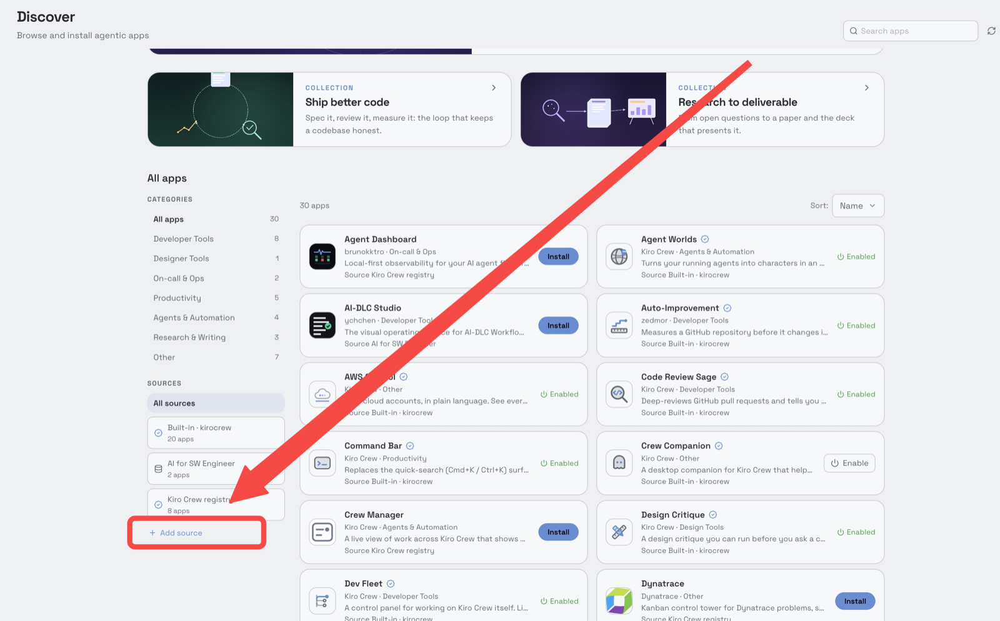

2. In the **External Registries** panel, paste the path printed by `pwd` into **Install from Path** and
   click **Install**.

   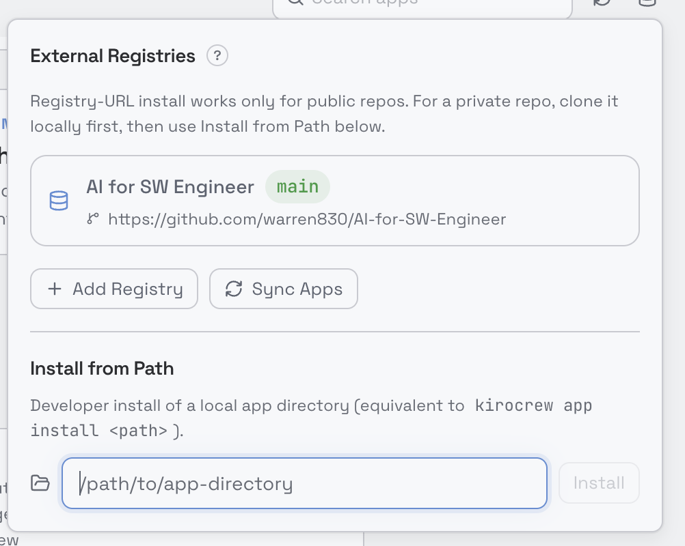

3. Open **Library**, find **AI-DLC Studio** and click **Enable**. If it is not listed, check whether
   **Show enabled only** is on. Once enabled, its **⋯** menu also offers **Sync** (for updates),
   **Disable** and **Uninstall**.

   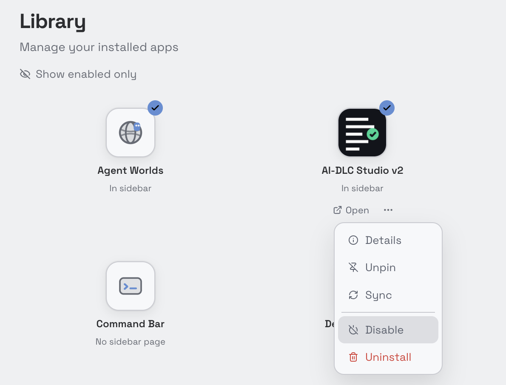

4. If KiroCrew opens the app's details and asks for trust, grant it to this app only. Blanket third-party
   trust is not needed.
5. **AI-DLC Studio** now appears in the sidebar. You can also open it from **Library → Open**.

The path must be a directory on the gateway's machine. If 1.x is already installed, KiroCrew refuses a
second install under the same name, so update it instead, as [Updating from 1.x](#updating-from-1x) says.

### Option B: The GitHub registry (installs 1.x, not v2)

This repository is also an app registry, but its `app-registry.json` lists the `release` branch, which
is the 1.x **AI-DLC Studio** (`aidlc-studio`). To install 1.x this way, add
`https://github.com/warren830/kirocrew-app-aidlc` with branch `release` in **Discover → Add source →
Add Registry**, then **Discover → AI-DLC Studio → Install**. The gateway clones the registry itself,
without your shell's proxy variables, so it needs direct access to GitHub.

<a id="updating-from-1x"></a>

### Updating from 1.x

2.0.0 keeps 1.x's name, `aidlc-studio`, so it replaces a 1.x install in place instead of installing beside
it. It needs KiroCrew 0.11.0 or newer, so update KiroCrew first. Then update Studio from where you installed it:

- **From a folder:** put the clone on the `v2` branch and sync it.

  ```bash
  git fetch origin
  git checkout -B v2 origin/v2
  ```

  Then use **Library → AI-DLC Studio → ⋯ → Sync**.
- **From Discover:** take the update KiroCrew offers for AI-DLC Studio once that source lists 2.0.0.

The update asks for two permissions 1.x did not have, `/api/models` and `/api/effort-levels`, which Studio's
model and effort pickers read. KiroCrew holds them until you click **Approve new permissions** under **This
version of AI-DLC Studio asks for new permissions** on AI-DLC Studio's page in KiroCrew. Studio stays enabled
in the meantime, though its pickers may offer only the default.

On its first start, 2.0.0 migrates Studio's database. Your activity, install receipts, install
transactions and settings are kept, so the repositories 1.x installed AI-DLC into upgrade and uninstall
from 2.0.0 as before. The tables 2.0.0 no longer reads are dropped. Because 2.0.0 bundles a newer AI-DLC,
those repositories then show **Upgrade available** on the Repos page. Upgrade each one when you choose.

If you installed the 2.0.0 beta from a folder as **AI-DLC Studio v2** (`aidlc-studio-v2`), it stays a
separate app with its own database, and 2.0.0 does not merge its data. KiroCrew refuses to sync it from a
folder that now names `aidlc-studio`. Upgrade or uninstall the repositories it installed AI-DLC into from
that app, because their install receipts are in its storage. Don't drive one repository from both Studios,
because each opens its own conversation for an intent.

## Step 2: Check the installation

Open **AI-DLC Studio → Settings** and scroll to **About**.

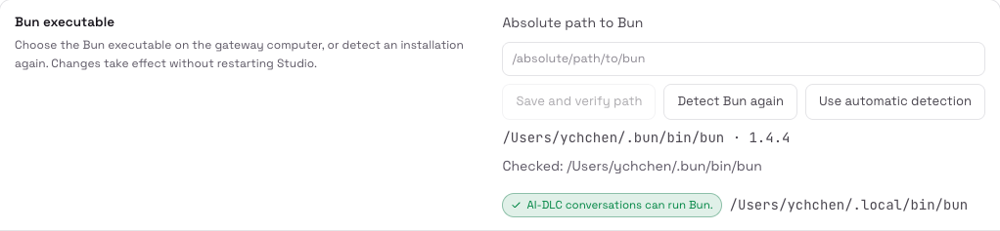

1. **Bun executable** should show Bun's path and version, such as `/Users/you/.bun/bin/bun · 1.4.4`.
   If it shows no path, only a **Checked:** list of the locations Studio searched, Bun was not found:
   - click **Detect Bun again**;
   - if it is still not found, run `command -v bun` on the gateway's machine, paste the full path into
     **Absolute path to Bun**, and click **Save and verify path**. Use the expanded path, not a literal
     `~` or `$HOME`. **Use automatic detection** returns to searching.

   A gateway started from the desktop app has a different `PATH` from your terminal, which is why a Bun
   that works in your terminal can still be missing here. Studio searches the gateway's `PATH`, then
   `~/.bun/bin/bun`, `/opt/homebrew/bin/bun`, `/usr/local/bin/bun` and
   `/home/linuxbrew/.linuxbrew/bin/bun`. Changes apply immediately, without restarting Studio.
2. The same row must also say **AI-DLC conversations can run Bun.** If it says
   **AI-DLC conversations cannot run Bun**, click **Make Bun available to conversations**, then
   **Create the link**. Studio creates one symbolic link, `~/.local/bin/bun`, which every conversation's
   `PATH` already includes, and changes nothing else. Delete the link to undo it. This is the usual case
   after the official installer on a desktop-launched gateway: skipping it makes AI-DLC refuse every
   decision.
3. **Status** should be **Healthy**, **Bundled payload** should report its files verified, and **Tools**
   should list both `bun` and `git` with versions.

From a terminal you can check the same health without changing anything:

```bash
bash scripts/kcapi.sh GET /api/apps/aidlc-studio/health
```

## A tour of the interface

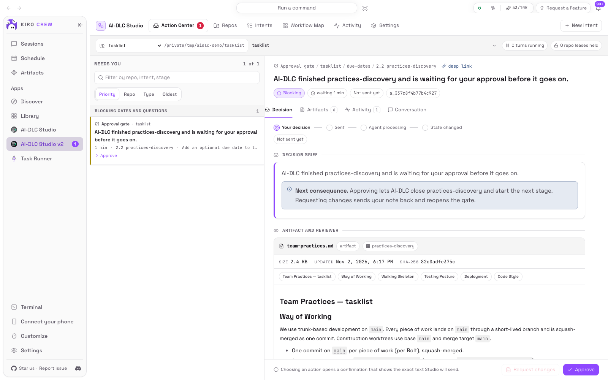

- **Top bar**: **Action Center** (with a count of what needs you), **Repos**, **Intents**,
  **Workflow Map**, **Activity**, **Settings**, and **New intent** on the right.
- **Scope bar**, under the top bar: choose **All repos** or one repository, and on pages that read one
  intent, the intent. Every page follows this scope.
- **Execution status**, at the right of the scope bar: turns running, repository leases held, recovery
  decisions and alerts. **Polling for updates** means the live event stream is not connected, so Studio
  re-reads on a timer: nothing is missed, updates are just slower.
- **Banners** across the top report a degraded environment (with **Open Settings**) or an expired
  dashboard session (reload the page; nothing was sent).
- **Notifications**: the count on the KiroCrew rail, plus optional Slack messages. See
  [Notifications](#notifications).

The interface is in English or Simplified Chinese, follows the dashboard's language by default, and has
light and dark themes. AI-DLC's own words (stage names, questions, artifacts, findings and audit fields)
are never translated.

## Your first intent, end to end

### 1. Register a repository

1. **Repos → Add repository**.
2. Click **Browse directories** and pick the project, then **Use this directory**, or type its
   **Absolute path** (a leading `~` is expanded). **Label (optional)** is how it appears in the queue and
   scope bar; empty means the directory name.
3. Click **Run preflight**. The read-only preflight shows the resolved path and identity, Git state,
   Bun's version and path, existing harnesses, the AI-DLC version and state layout on disk, free space,
   write permission, and any warning. Studio runs nothing in the directory and writes nothing to it.
4. When it says **This path can be registered.**, click **Register this path**.

Studio refuses a second registration of the same repository under another path (**Already registered**),
because its leases are keyed on the repository's identity.

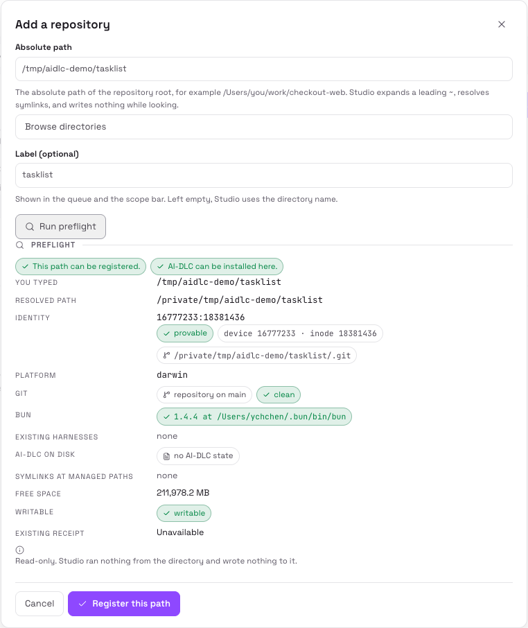

### 2. Install AI-DLC into it

Open the repository (**Details**) and click **Install AI-DLC**. The **Install preview** lists every
managed path, who will own it, and what happens to it. Nothing has been written yet.

- Files the framework owns are created and recorded with their digests in an **install receipt**.
- Your `.kiro/settings/*.json` files are merge targets: Studio adds and owns only its own fragment and
  leaves the rest, including secrets, untouched.
- An existing `aidlc/` workspace is left exactly as it is.
- Studio writes no `AGENTS.md` and no `.gitignore`; AI-DLC adds its own marked part to each when the
  first intent is created.
- **Conflicts that stop this** lists any file at a managed path that differs from what Studio would
  install, with its diff. There is no force option: move the file aside yourself, or leave the repository
  as it is.

Click **Install AI-DLC 2.11.3** to confirm. The transaction drawer shows each step: acquire the admin
lease, stage and verify the payload, back up, write, merge fragments, validate, commit the receipt. A
failure restores the starting state. If the repository changed while you read the preview, nothing is
written and the preview is re-read for you to check again.

### 3. Create an intent

Click **New intent**. The wizard has four steps, and nothing is written until you click **Create**.

1. **Work**
   - **Repository**: only registered repositories with AI-DLC installed can be chosen.
   - **Space**: AI-DLC creates an intent in its active space only. Change the active space on the
     repository's page ([Spaces](#spaces)).
   - **Objective**: one sentence, which the engine reads as the intent's input. Start it with a word: a
     leading `-` would be read as an option.
   - **Context the engine should know**: optional; sent after the objective. The counter shows how many
     characters AI-DLC accepts for the two together. Attach a long document to the intent once it exists.
   - **Label**: at most three lowercase words joined by hyphens, such as `guest-checkout`. It becomes the
     intent's directory name and cannot be renamed later. Left empty, AI-DLC derives one from the
     objective.
   - **Project type**: optional; it helps the engine decide whether conditional stages apply.
2. **Preset**
   - **Scope**: which of AI-DLC's stages are eligible. The list is read from the repository, including any
     scope the project defines.
   - **Depth**: Minimal (one pass per stage, fewer questions), Standard (questions where the engine needs
     you), or Comprehensive (more questions, longer artifacts).
   - **Review cap**: the strongest review any stage may use. none (no reviewer; Gates still need you),
     advisory (comments that do not block), or adversarial (findings must be answered before a Gate can
     pass).
   - **Test strategy**: Minimal (smoke), Standard (unit plus integration), or Comprehensive (adds
     performance validation).
   - **Let the Advisor propose these settings** reads your objective and the repository and proposes all
     of the above. **Use this proposal** fills the fields; you can change any of them.
3. **Plan**: every stage AI-DLC knows, in its five phases, with what it produces and consumes. Turn
   stages on or off. A stage you cannot change says why (always runs, required by another stage, already
   done). If the combination breaks a dependency, **Why AI-DLC will not accept this plan** says what is
   missing. The plan diff shows what you changed against the preset and its downstream effects.
4. **Review**: exact stage, Gate and artifact counts from the installed graph, estimates with their
   source and confidence, the products the plan declares, and the plan fingerprint. If the installed graph
   or scope changed since this preview, AI-DLC refuses rather than create a plan you did not see.

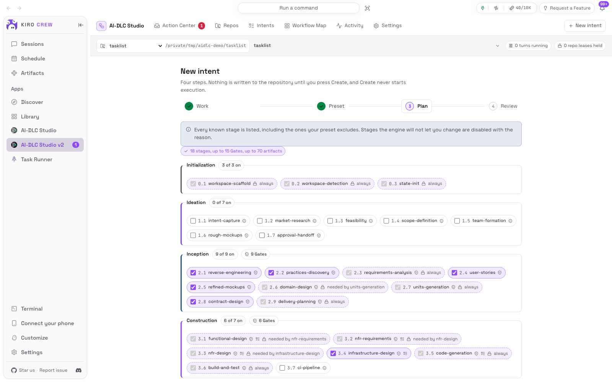

Click **Create the intent, paused**. AI-DLC writes the intent record and compiles its runtime graph;
**no workflow turn runs**. If compilation fails after creation, click **Retry runtime compilation** on the
same intent instead of creating another one.

### 4. Bind a conversation and start

Open **Intents** (the wizard links to it). A new intent has no conversation, so its row leads with
**Bind a conversation**. Every decision for an intent is refused until it has one.

The conversation panel shows the repository, project and agent (`aidlc`) and offers:

- **Create the conversation and continue (sends `/aidlc`)**: creates a KiroCrew conversation, titles it,
  points it at this repository, switches it to the `aidlc` agent, binds it to this intent, files it in the
  sidebar under the repository's folder, and sends `/aidlc` once. It says *continue* because creating the
  intent already completed AI-DLC's initialization stages; it says *start* for an intent with no stage done.
- **Create and bind only**: the same without sending anything.
- **Bind an existing conversation**: lists conversations already open on this repository with the `aidlc`
  agent. Studio refuses any other.

With a conversation bound, **Run to next checkpoint** confirms and sends `/aidlc`. AI-DLC then works until
it reaches something that needs you, fails, or completes. It never continues past a checkpoint on its
own.

### 5. Answer checkpoints in the Action Center

When AI-DLC stops for you, a card appears in the **Action Center** and a notification arrives.

1. Select the card. Read its evidence on the **Decision**, **Artifacts**, **Review**, **Activity** and
   **Conversation** tabs.
2. Choose a decision: for a Gate, **Approve** or **Request changes** (with a note); for questions, fill in
   the form and **Send answers**.
3. The confirmation shows the button you chose and the exact text that will be sent, for example
   `Button: Approve → sends: …`. Click **Yes, send this exact text**.
4. The delivery strip tracks it: **Your decision → Sent → Agent processing → State changed**. The card
   clears only when AI-DLC's audit trail and state file show it acted on your decision, not when a
   request returned success.

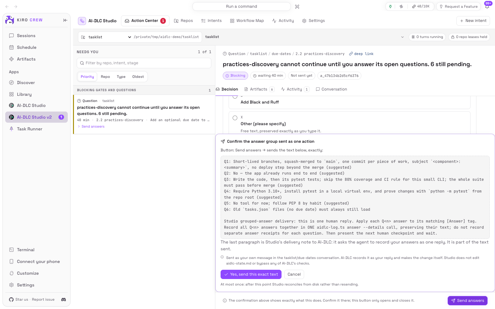

AI-DLC continues to the next checkpoint by itself after it accepts your decision. Repeat until the
workflow completes.

### 6. Follow progress

- **Intents** shows each intent's state, current stage and progress.
- **Workflow Map** draws the plan as phase swimlanes with live stage state.
- **Activity** is the timeline of everything that happened, with its source.

### 7. Finish and commit

Studio never runs a Git write. When an intent is complete, its Intents row offers **Prepare commit**,
which asks the intent's conversation to commit the changes the workflow made, without pushing. You
confirm the exact request first. **Repos → Git observation** then shows the result.

## Action Center

### The queue

**Needs you** lists every card from every registered repository in the current scope. Organize it with
**Priority** (default), **Repo**, **Type** or **Oldest**; Settings remembers your choice. In priority
order the groups are:

1. Recovery required and delivery uncertain
2. Blocking Gates and questions
3. Circuit breakers, failures, and install conflicts
4. Requests, budget stops and pauses

Within a group the oldest comes first. **Filter by repo, intent, stage** narrows the list. An empty queue
says **Nothing needs your judgment**.

### Card types

| Card | What it means | What you can do |
|---|---|---|
| Approval gate | A stage finished and waits for approval | **Approve**, **Request changes**; **Accept as-is** only after the engine has offered it |
| Question | A stage cannot continue until you answer | **Send answers**; for some checkpoints **Confirm the summary**, **Accept the assumptions** or **Turn them into follow-up questions** |
| Plan approval | A stage waits for you to approve its plan | **Approve plan**, **Request plan changes** |
| Missing input | AI-DLC needs something before it can start, or asked you in the conversation | **Send the input**; **Make this the active intent** when the space has no active intent |
| Revision in progress | A stage is being revised after your feedback | Information only |
| Recovery | The evidence disagrees, or the bound conversation is lost | **Rebind the conversation**, **Record as never sent**, **Acknowledge** |
| Delivery uncertain | Studio cannot prove your last decision arrived | **Reconcile from disk**, **Record as never sent**, **Send it again** |
| Failure | The engine failed on a stage | **Retry now**, **Keep paused** |
| Repeated failures | Dispatch stopped after several failures of the same kind | **Retry now**, **Keep paused** |
| Install conflict | A Studio-managed file differs from what was installed | Links to the repository's page |
| Budget stop | A budget stopped the intent before the next turn | **Run now**, **Keep paused** |
| Run, Resume, Prepare commit | A command you started that did not go through | Send it again from the card |

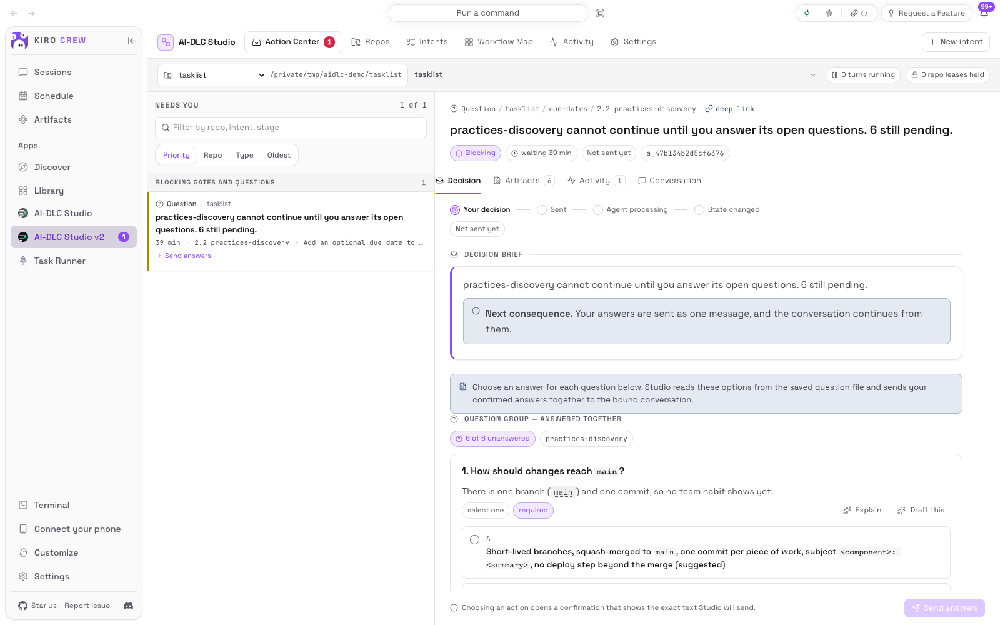

### Decision detail

- **Decision**: the headline, the consequence of each choice, and the controls. A Gate also lists the
  stage's acceptance criteria and unresolved risks.
- **Artifacts**: the files the stage produced, earlier revisions and their diff. Studio reads them and
  never edits them; **Request changes** asks the AI to revise.
- **Review**: the review contract, reviewer findings grouped as open blockers, advisory or answered, and
  AI-DLC's review receipts. Findings are quoted verbatim.
- **Activity**: this intent's events.
- **Conversation**: the intent conversation's own transcript. Anything you type there is your turn.

**deep link** copies a link that reopens this decision.

### Delivery states

| State | Meaning |
|---|---|
| Not sent yet | Recorded, not sent |
| Sending | Being delivered to the conversation |
| Sent | The conversation received it |
| Being processed | AI-DLC is working on it |
| Applied | AI-DLC recorded it and the workflow moved |
| Answered | AI-DLC recorded it without a workflow transition |
| Not sent | Proven never to have reached the conversation |
| Needs reconciliation | Delivered or possibly delivered, outcome not yet proven |
| Failed, Cancelled | Ended without effect |

Every decision is sent at most once. If the conversation was busy or another operation held the
repository, nothing is sent and the card says so: send again once it is free. If you were deciding while
the evidence changed, Studio shows the refreshed evidence and asks you to confirm again.

### When delivery is uncertain

Studio never resends on its own. It keeps watching AI-DLC's files for the outcome. You can:

- **Reconcile from disk**: re-read the files and the conversation now;
- **Record as never sent**: Studio checks its own proof first and refuses if it cannot show that;
- **Send it again**: queue the decision as a new item, after confirming you have read the delivery
  evidence. Studio refuses if it can show the first attempt arrived.

### The AI Advisor

The Advisor is an optional, read-only helper running in its own session. It cannot write files, run
commands, move the workflow, or reply to AI-DLC as you, and what it does is recorded in Studio's Activity
only, never in AI-DLC's audit trail.

- On a Gate: **Ask the Advisor** (**Analyze this decision**, **Draft change-request feedback**). It returns
  a reading, evidence, assumptions, alternatives and confidence. **Put the drafted feedback in the box**
  fills the note for you to edit.
- On questions: **Draft all answers**, **Draft this** or **Explain**. **Apply the drafted selections**
  fills the form; Approve is never preselected.
- On failures and recovery: **Diagnose with AI**.

A draft takes about three minutes. To have drafts ready when you open a card, tick the repository under
**Settings → Advisor → Draft ahead, per repository**; this spends model usage on every card, so it is off
by default.

### Tool approvals

When the conversation waits for you to approve a tool call, the Intents row says so, and a notification
arrives. Allow, trust or reject it in the conversation itself: **Open the conversation**.

## Intents

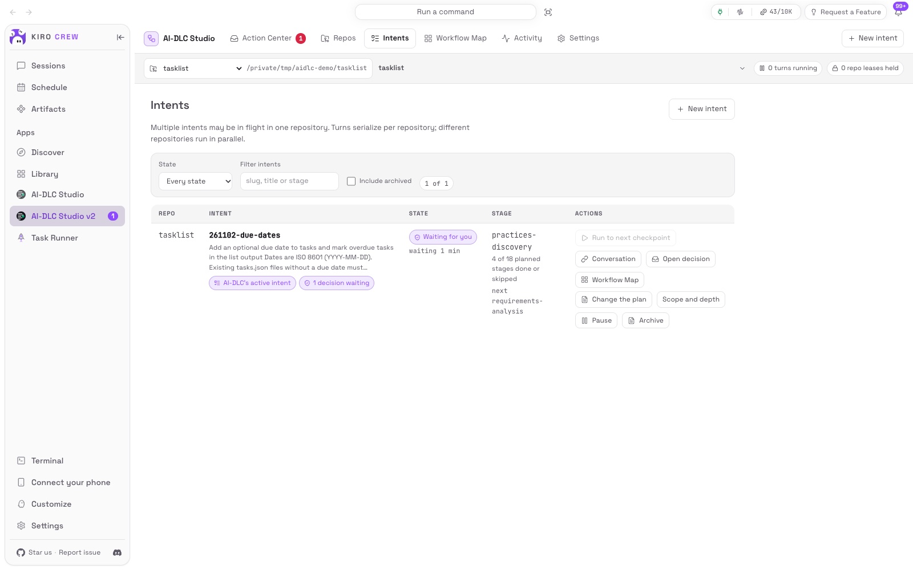

One row per intent in the current scope, with its repository, state, current and next stage, progress
("3 of 33 stages done or skipped"), waiting decisions and findings. Chips mark **AI-DLC's active intent**,
**Paused** and **Archived**. Filter by **State**, **Space** or text, and tick **Include archived** to see
archived intents. Several intents can be in flight in one repository: turns run one at a time per
repository, and different repositories run in parallel.

| Button | What it does |
|---|---|
| **Bind a conversation** / **Conversation** | Opens the conversation panel: create, bind, **Move to another conversation**, **Unbind**, **Open in KiroCrew** |
| **Run to next checkpoint** | Sends `/aidlc` once after confirmation; disabled while a turn runs, while a checkpoint waits, or when complete |
| **Resume** | Sends `/aidlc --resume`; offered only for an intent AI-DLC parked |
| **Open decision** | Opens the intent's waiting card in the Action Center |
| **Workflow Map** | Opens the intent's map |
| **Change the plan** | Turns pending stages ahead of AI-DLC's cursor on or off, through AI-DLC's own recompose command; sends no message |
| **Scope and depth** | Previews and applies a new scope, depth or test strategy. Completed stages keep their history |
| **Pause** / **Pause after current turn** | Stops Studio sending anything for this intent; a running turn finishes. Waiting decisions refuse to send while paused |
| **Allow dispatch again** | Ends the pause; sends nothing |
| **Archive** / **Restore** | Hides the intent from default views, in Studio only. No AI-DLC file changes. An intent with waiting decisions is paused first |
| **Prepare commit** | On a completed intent: asks its conversation to commit without pushing |

When the last turn stopped on a KiroCrew error, the row says so. AI-DLC keeps what it already wrote, and
**Run to next checkpoint** picks up from there once the cause is fixed.

Unbinding only forgets which conversation the intent uses; the conversation and every AI-DLC file stay.
Moving is refused while a decision for the intent may still be in flight.

## Workflow Map

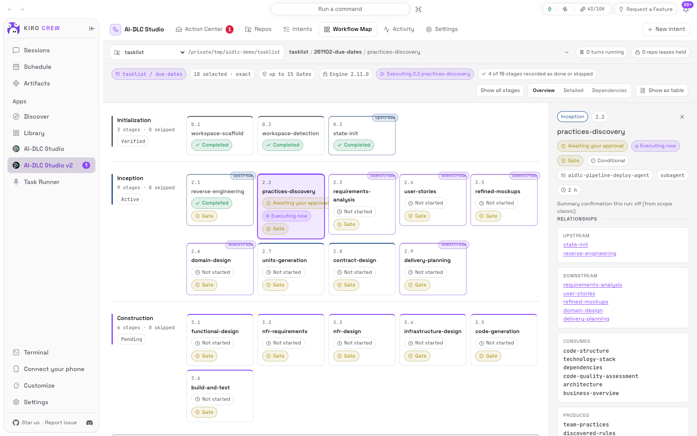

The map draws one intent (chosen in the scope bar) as swimlanes for AI-DLC's five phases: Initialization,
Ideation, Inception, Construction and Operation. Each stage card shows its state, lead agent, Gate,
review class, elapsed time and files; **Executing now** marks the current stage.

- **Show all stages** also draws the stages this plan excludes, with the reason. Stage numbers never
  change. **Show current plan only** returns to the plan.
- **Density**: **Overview**, **Detailed**, or **Dependencies** (draws upstream and downstream links).
- **Expand unit sub-lanes** splits Construction into one lane per unit of work.
- **Show as table** lists the visible stages instead.

Select a stage to open the **Stage inspector**: why it is or is not executing, what it consumes and
produces, its files (click to open), its review contract and findings, its recent audit events, and the
one **Eligible operation** it permits, such as opening its Gate in the Action Center. On a narrow screen
the phases become accordions.

## Activity

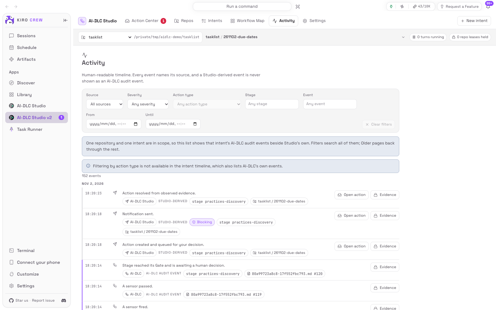

A readable timeline. Every row names its source: **AI-DLC**, **KiroCrew**, **Git** or **AI-DLC Studio**,
and a Studio-derived event is never shown as an AI-DLC audit event.

- With **All repos** in scope, the timeline shows Studio's own records. Choose one repository and one
  intent in the scope bar to read that intent's AI-DLC audit events beside them.
- Filter by **Source**, stage, event, action type, severity, and time range. **Older** and **Newer** page
  through history.
- **Evidence** on a row opens the **Evidence drawer**: provenance, the raw audit block
  (**Copy the raw block**), the file location and the recorded values. Credentials are removed, and paths
  outside the registered repository are not shown.
- **Diagnostic export** produces a downloadable bundle of health, versions, settings, repositories,
  actions, leases, transactions and recent activity, for a bug report. It removes credentials, scrubs
  paths, omits artifact contents, and omits the text you sent unless you allow it in Settings first.

## Repos

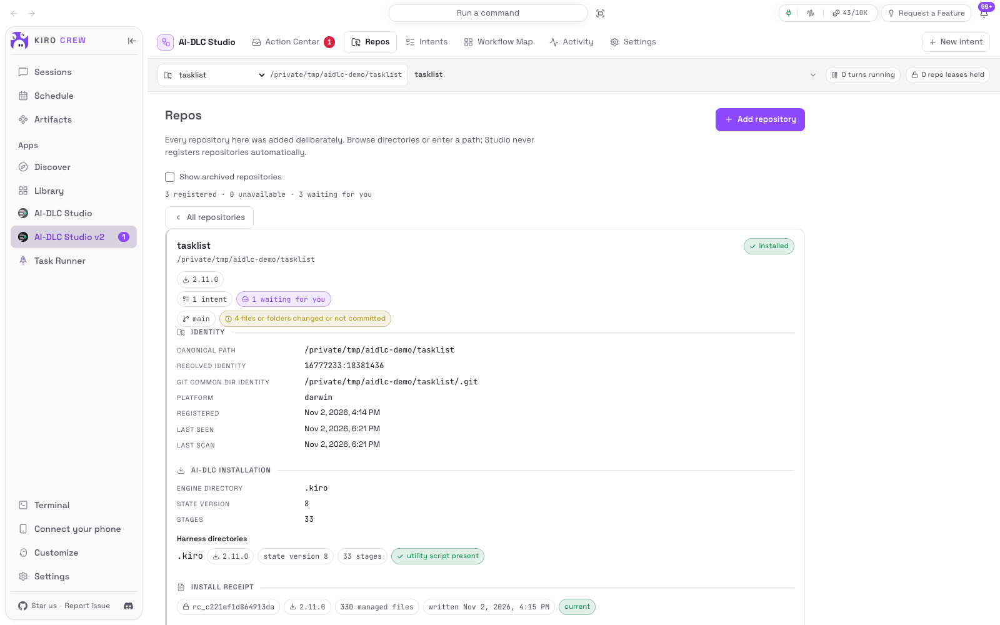

The list shows every registered repository with its AI-DLC state, engine version, Git state, intent count
and queue count. **Show archived repositories** includes archived ones. Open one for its details.

### Availability

If a repository is not readable, its page says why and what to do:

| Shown | Do this |
|---|---|
| Moved | **Rebind to a new path**: its intents, actions and history stay attached |
| Permission denied | Restore read access, then **Rescan** |
| Unavailable | **Rescan** when it is back, or **Unregister** |
| Identity unprovable | Resolve the duplicate directory; execution and installation stay disabled until then |

### AI-DLC installation and maintenance

Every operation below starts with a preview, writes only after you confirm, holds an exclusive admin
lease (so it waits for a running turn and never interrupts one), and restores its starting state on
failure.

| Button | When | What it does |
|---|---|---|
| **Install AI-DLC** | Not installed | Installs the bundled harness with a receipt |
| **Upgrade AI-DLC** | **Upgrade available** | Moves to the bundled version. A file you changed blocks the upgrade with its diff. Retired files are removed only if unchanged |
| **Update AI-DLC files** | **Updated files available** | Applies newer files of the same version |
| **Restore AI-DLC files** | **Modified since install** | Re-creates missing files and rewrites the ones Studio may replace. Your edits block it until you resolve them |
| **Roll back engine version** | After an upgrade | Restores the immediately preceding compatible engine from its backups |
| **Uninstall harness** | Installed | Removes receipt-owned files and fragments. Workflow data, project files and changed configurable files stay, and are listed |
| **Install recovery** | **Install recovery required** | Clears a rollback that did not finish, with its own preview and validation. AI-DLC cannot run in the repository until it clears |
| **Run AI-DLC doctor** | Any time | AI-DLC's own health check. It adds two entries to the audit trail, so it runs only when you ask |

While an install is running, **Cancel and roll back installation** waits for the current file operation,
then restores the backups. **Install history** lists each transaction; open one for its steps.

Studio will not install over a newer AI-DLC than it bundles, and will not write a repository whose AI-DLC
state version it cannot prove safe to migrate. Either case is shown, and the repository stays readable.

### Git observation

Branch, HEAD, upstream, ahead or behind, and changed files, split into receipt-owned files with local
changes (these block an upgrade), code an intent wrote that is not committed yet, and everything else.
Studio only reads Git: it never commits, pushes, checks out, stashes or resets.

### Spaces

Shows the active space. **Create space** makes a new one with fresh team memory seeded from the default
space; the active space does not change. **Switch space** changes the repository's active space; a running
turn blocks it.

### Clean up transaction files

Lists the backup and failed-attempt directories transactions left outside the repository, with size and
protection. Select old ones, **Preview selected cleanup**, then **Delete the reviewed directories**.
Directories needed by the current installation, an active transaction or a recovery are protected.
Deleting an older backup removes that rollback point.

### Rename, archive, unregister

**Rename repository** changes its label. **Archive repository** hides it from the active list, keeping its
files, bindings and history; restore it from **Show archived repositories**. **Unregister** forgets the
registration, its bindings and its actions. None of these changes a byte inside the repository.

## Settings

Studio's own preferences. Nothing here changes AI-DLC files.

| Section | Settings |
|---|---|
| Language and display | **Interface language** (Follow the dashboard, English, 简体中文); **Density** (Compact, Comfortable) |
| Action queue | **Order the queue by**: Priority, Repository, Action type, Oldest first |
| Automation and budgets | **Global concurrency**: how many repositories may run a turn at once (each repository always runs one at a time); **Run doctor after an install or upgrade** |
| Advisor | **Offer the Advisor on decisions**; **Draft ahead, per repository**; the Advisor model, which KiroCrew assigns |
| Notifications | **Send Slack notifications** and **Muted repositories**; **Show dashboard notifications** |
| Diagnostics | Days of activity history kept; **Allow prompt bodies in a diagnostic export** (off by default); days the text you sent is kept (1 to 30) |
| About | **Bun executable**; Studio app and bundled AI-DLC versions; minimum and current KiroCrew version; platform; status; payload, tools, storage and reconciler health |

### Notifications

New Gates, questions, failures, uncertain deliveries, tool approvals and completions raise a dashboard
notification. Slack messages, when KiroCrew has Slack set up, go to the owner's direct messages and cover
blocking events only. A Slack message links back to Studio, where you decide: KiroCrew cannot pass a Slack
button press back to Studio as a verified decision.

### Unattended runs

Studio has no unattended mode. Every way of delivering text to a conversation counts as a person's turn
to AI-DLC, so Studio stops at every checkpoint and sends only what you confirm.

## Using Studio on a phone

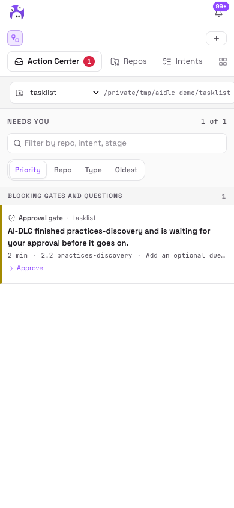 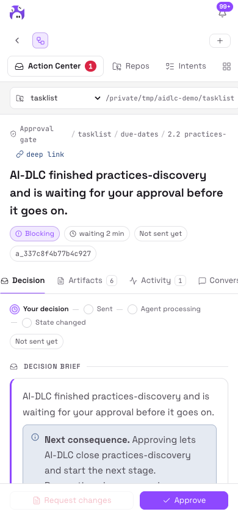

The Action Center queue and the decision detail work at 390px wide, so you can read evidence and decide
from a phone. Registering a repository and installing, upgrading or recovering AI-DLC are desktop-only.

## Update, rebuild or uninstall Studio

### Update

Update when no Studio operation is running. Pull the new code into your clone first:

```bash
git pull --ff-only
```

Then use **Library → AI-DLC Studio → ⋯ → Sync**. KiroCrew re-syncs from the directory and reloads the
backend.

A new Studio may bundle a newer AI-DLC. Repositories then show **Upgrade available** on the Repos page;
upgrade each one when you choose.

### Rebuild the UI

Only after editing the UI source. The locked Vite dependency needs Node.js `^20.19.0 || >=22.12.0`:

```bash
(cd ui && npm ci && npm run build)   # builds ui/dist/index.mjs
```

Then use **Library → AI-DLC Studio → ⋯ → Sync**.

### Uninstall

To remove AI-DLC from a repository too, use **Repos → Uninstall harness** first: the install receipts that
make a safe uninstall possible are kept in Studio's own storage. Then use
**Library → AI-DLC Studio → ⋯ → Uninstall**.

## Troubleshooting

| Symptom | What to do |
|---|---|
| `bun: command not found` in a terminal | Follow [Step 0](#step-0-install-bun-first), add Bun to `PATH`, open a new terminal, run `bun --version` |
| On Windows, Bun runs in PowerShell but Studio cannot find it | Studio runs in WSL: install Bun again in the Ubuntu terminal, following [Step 0](#step-0-install-bun-first) |
| Terminal runs Bun, but Studio says **Bun was not found** | Run `command -v bun` on the gateway's machine, paste the result into **Settings → About → Absolute path to Bun**, **Save and verify path** |
| **AI-DLC conversations cannot run Bun**, or every approval is refused | **Make Bun available to conversations → Create the link** |
| "~/.local/bin is not on this gateway's conversation PATH" | Add Bun's directory to KiroCrew's agent environment (`agent.env` `PATH`) and restart the gateway |
| Install from Path says `source is not a directory` | Use the absolute path of the clone on the gateway's machine (`pwd` in the clone) |
| Enable in Library opens the app's details | Grant trust to AI-DLC Studio there; click **Enable** again if needed |
| **New intent** cannot choose a repository | Install AI-DLC in it, or complete its install recovery, on the Repos page |
| A decision is refused: "This intent has no conversation bound yet" | **Intents → Bind a conversation** |
| "Another operation holds this repository" | Wait for the install, doctor or turn to finish, then send again. Nothing was sent |
| "The situation changed while you were deciding" | Read the refreshed evidence and confirm again |
| "AI-DLC's files disagree with each other" | Open the Recovery card and follow it; nothing is sent until the files agree |
| "AI-DLC's active intent is not the one this decision belongs to" | Studio switches the intent when it can; otherwise use **Make this the active intent** on the card |
| **Delivery uncertain** | See [When delivery is uncertain](#when-delivery-is-uncertain). Studio never resends by itself |
| Last turn stopped on an error | Fix the cause in KiroCrew (the conversation offers it), then **Run to next checkpoint** |
| Page open, but AI-DLC does not run in a project | Check [Step 2](#step-2-check-the-installation), that `kiro-cli` is signed in, and that AI-DLC is installed in that repository |
| "Your dashboard session has expired" | Reload the page. Nothing was sent |

When asking for help, attach a **Diagnostic export** from the Activity page.

## Learn more

- [README](../README.md): why Studio exists, how a decision reaches AI-DLC, what Studio deliberately does
  not do, the permissions it requests, and development.
- [Architecture](design/architecture.md) and [contracts](design/contracts.md): how it is built.
- [Docker installation verification](verification/2026-09-17-docker-install/README.md): a recorded install
  on Linux ARM64 in the official KiroCrew image.
