# AI-DLC Studio 使用指南

[English](user-guide.md) | **简体中文**

本指南从一台什么都没装的机器开始，一路带你跑完一个 AI-DLC 意图，然后逐页说明 Studio 的每个功能。适用于
**AI-DLC Studio**（`aidlc-studio`，2.0.0 测试版），内置 AI-DLC **2.11.3**，需要 KiroCrew **0.11.0**
或更新版本。

> [!IMPORTANT]
> **在一切开始之前，先安装 Bun。** AI-DLC 的引擎，以及每个 AI-DLC 会话里的 hook，都是由 Bun 运行的
> TypeScript 程序。没有 Bun，Studio 页面虽然能打开，但无法给仓库安装 AI-DLC、无法新建意图、无法计算计划、
> 无法运行 AI-DLC doctor；而且你发出的每一个批准和答复都会被 AI-DLC 拒绝，因为它的 hook 无法记录“这是人发的”。
> 请先在运行 KiroCrew Gateway 的机器上安装 Bun：[第 0 步](#step-0)。

## 目录

1. [开始之前](#before-you-start)
2. [Windows：在 WSL 2 里运行](#windows)
3. [第 0 步：先安装 Bun](#step-0)
4. [第 1 步：把 Studio 安装到 KiroCrew](#step-1)
5. [第 2 步：检查安装结果](#step-2)
6. [界面导览](#tour)
7. [从零跑完第一个意图](#first-intent)
8. [待办中心](#action-center)
9. [意图](#intents)
10. [流程图](#workflow-map)
11. [活动](#activity)
12. [仓库](#repos)
13. [设置](#settings)
14. [在手机上使用](#mobile)
15. [更新、重新构建或卸载 Studio](#update)
16. [常见问题](#troubleshooting)

<a id="before-you-start"></a>

## 开始之前

### 需要准备什么

| | |
|---|---|
| **Bun** | 必需，并且要最先安装：[第 0 步](#step-0)。建议用 1.4.4 或更新版本：AI-DLC 2.11.3 的发布说明要求 copy 通道的安装（Studio 内置的就是）把 Bun 升到 1.4.4，以修复 CVE-2026-111497。Studio 不强制检查 |
| KiroCrew | 0.11.0 或更新版本，并已启动 |
| 平台 | macOS 或 Linux。Windows 请在 WSL 2 里运行，见 [Windows](#windows) |
| `kiro-cli` | 已登录，且登录用户与运行 Gateway 的系统用户相同 |
| Kiro 订阅 | 支持 AI-DLC 所用模型的付费订阅 |
| Git | 用于克隆 Studio。在项目仓库里是可选的：没有 Git 时 Studio 显示“Git 观测未启用” |
| Node.js 和 npm | 只有重新构建 Studio UI 时才需要，安装时用不到 |

### 命令在哪里执行

本指南的所有命令，都要**在运行 KiroCrew Gateway 的机器上，以运行 Gateway 的同一系统用户**执行。Gateway 在
远程服务器或 Docker 容器里时，就到那里执行（容器用 `docker exec -it <容器名> bash` 进入）。你给 Studio 填的
仓库路径，也都是那台机器上的路径。

### 本指南用到的术语

| 术语 | 含义 |
|---|---|
| 仓库 | 你在 Studio 里登记的项目目录。Studio 从不自动发现或登记仓库 |
| 引擎文件（harness） | 安装进仓库的 AI-DLC 文件（`.kiro/` 下的内容，加上 `aidlc/` 工作区） |
| 空间 | 仓库里的一个 AI-DLC 工作区，各有自己的意图和团队记忆 |
| 意图（intent） | AI-DLC 带着走完各阶段的一项工作，例如“支持游客结账” |
| 阶段、关卡 | AI-DLC 方法中的一步；关卡（Gate）是需要你批准才能继续的阶段 |
| 检查点 | AI-DLC 停下来等人的地方：关卡、提问、计划批准、缺少输入 |
| 会话 | 某个意图绑定的那个 KiroCrew 对话，运行 `aidlc` agent。Studio 把你的决定以你本人消息的形式发到这里 |
| 卡片 | 待办中心队列里的一项 |

<a id="windows"></a>

## Windows：在 WSL 2 里运行

KiroCrew 本身可以直接装在 Windows 上（官方安装包 `KiroCrew-Setup.exe`），但 **Studio 目前还不能在原生 Windows 上运行**：

- Studio 的后端用到了只有 macOS 和 Linux 才有的文件锁（`fcntl`）。在 Windows 版 KiroCrew 里，Studio 能装上，但后端加载会失败。
- KiroCrew 在 Windows 上暂不支持项目级 skills（`<项目>/.kiro/skills`），而 AI-DLC 正是装在项目的 `.kiro/` 下。
- `app.json` 声明的平台只有 macOS 和 Linux，Studio 也还没有在 Windows 上做过验证。

所以在 Windows 上，请把 KiroCrew Gateway 跑在 WSL 2 的 Linux 里，再用 Windows 的浏览器访问。如果已经在 Windows 上直接装了
KiroCrew，先退出它：两边默认都用 5476 端口。

> [!WARNING]
> 这条路径还没有在 Windows 主机上做过端到端验证，它依靠的是 Studio 已支持的 Linux 环境。遇到问题时，请附上活动页的
> **诊断导出** 反馈。

需要 Windows 10 2004（内部版本 19041）或更新版本，或 Windows 11。

1. 以管理员身份打开 PowerShell，安装 WSL 2 和 Ubuntu，按提示重启并创建 Linux 用户：

   ```powershell
   wsl --install -d Ubuntu
   ```

2. 打开开始菜单里的 **Ubuntu** 终端，装好基础工具：

   ```bash
   sudo apt update && sudo apt install -y curl unzip git
   ```

3. **在 WSL 里**安装 Bun：在 Ubuntu 终端里按 [第 0 步](#step-0) 的 Linux 步骤执行。在 PowerShell 里装的 Windows 版 Bun，
   WSL 里的 Gateway 和会话都用不到。
4. 在 Ubuntu 终端里用 KiroCrew 官方的一行命令安装 KiroCrew，并以同一个 Linux 用户登录 `kiro-cli`：

   ```bash
   curl -fsSL https://download.crew.kiro.dev/cli.sh | sh
   ```

   版本选择、首次设置和升级，见 [KiroCrew 安装指南](https://github.com/kirodotdev/KiroCrew/blob/main/docs/guides/install.md)。
5. 继续在 WSL 里做 [第 1 步](#step-1)：把仓库克隆到 Linux 文件系统里（例如 `~/work`）。
6. 在 Windows 的浏览器里打开 `http://localhost:5476`。WSL 2 默认会把 localhost 端口转发给 Windows。然后照常做
   [第 2 步](#step-2)。

也可以用 Docker Desktop 运行 KiroCrew 官方镜像，命令来自 KiroCrew 的 README，端口只绑定在本机：

```bash
docker run -d --name kirocrew \
  -p 127.0.0.1:5476:5476 \
  -v kirocrew-home:/home/kirocrew \
  ghcr.io/kirodotdev/kirocrew:stable
```

然后用 `docker exec -it kirocrew bash` 进入容器，在容器里按 Linux 步骤安装 Bun 和 Studio（见
[Docker 验证记录](verification/2026-09-17-docker-install/README.md)）。

注意：

- 填给 Studio 的路径都是 WSL（或容器）里的 Linux 路径，例如 `/home/<你>/work/tasklist`，包括 **Install from Path**
  和 **添加仓库**。
- 要登记的项目也放在 WSL 的文件系统里，不要用 `/mnt/c/...` 下的 Windows 盘：经过 WSL 读写 Windows 盘慢得多，而 Studio
  靠稳定的文件身份（设备号和 inode）来区分仓库。

<a id="step-0"></a>

## 第 0 步：先安装 Bun

请在**安装 Studio 之前、最好在启动 KiroCrew 之前**装好 Bun，这样 Gateway 和它启动的每个会话都能找到它。Windows 用户要装在 WSL 里，见 [Windows](#windows)。

### 为什么必须最先装

Studio 做准备工作时会调用 AI-DLC 自己的引擎，AI-DLC 的 hook 也在每个会话里运行，两者都需要 Bun。没有 Bun 时：

- 仓库预检会提示 `bun：未找到`；
- **安装 AI-DLC**、**新建意图**、计划预览、**运行 AI-DLC doctor**、空间操作都会失败，提示
  “在 PATH 和常见安装位置中都没有找到 bun”；
- 在会话里，AI-DLC 的 hook 会静默失败，记录不到人工回合，于是 Studio 替你发出的每个批准和答复都会被 AI-DLC 拒绝。

### macOS（13 及以上）或 Linux：官方安装脚本

```bash
curl -fsSL https://bun.com/install | bash

# 让默认安装位置在当前终端立即生效。
export PATH="$HOME/.bun/bin:$PATH"
bun --version
command -v bun
```

`bun --version` 应输出版本号，`command -v bun` 应输出可执行文件路径。请记下这个路径，[第 2 步](#step-2)
可能要用到。

Linux 上该脚本需要 `unzip`。Debian/Ubuntu 缺少相关命令时先执行 `sudo apt install curl unzip`；其他发行版用
各自的包管理器安装。

如果新开的终端提示 `bun: command not found`，把下面这行加到 zsh 的 `~/.zshrc`，或 Bash 的 `~/.bashrc`
（登录 shell 用 `~/.bash_profile`），然后重新打开终端：

```bash
export PATH="$HOME/.bun/bin:$PATH"
```

这是官方脚本的默认安装位置；如果你改过安装目录，请换成实际目录。

### 另一种方式：Homebrew

```bash
brew install oven-sh/bun/bun
bun --version
command -v bun
```

在 macOS 上，Homebrew 把 Bun 装在 `/opt/homebrew/bin`（Apple Silicon）或 `/usr/local/bin`（Intel），
KiroCrew 给每个会话的 `PATH` 本来就包含这两个目录。

### 如果 KiroCrew 已经在运行

不需要重启。装好 Studio 后，打开 **设置 → 关于 → Bun 可执行文件**，点击 **重新探测 Bun**，然后按
[第 2 步](#step-2) 检查。

<a id="step-1"></a>

## 第 1 步：把 Studio 安装到 KiroCrew

在 Gateway 所在机器上克隆 `v2` 分支，并记下目录的绝对路径：

```bash
git clone -b v2 https://github.com/warren830/kirocrew-app-aidlc.git
cd kirocrew-app-aidlc
pwd
```

`-b v2` 不能省：仓库的默认分支 `main` 是 1.x 版本。仓库里已经带了构建好的 UI，安装不需要 Node.js
或 npm。

### 方式一：在 Discover 中从本地路径安装（推荐）

1. 在 KiroCrew 中打开 **Discover**，点击左侧 **Sources** 列表底部的 **Add source**。

   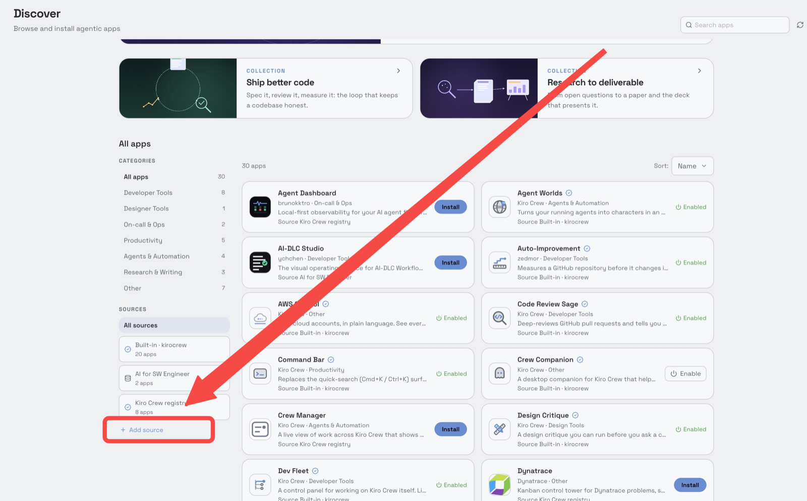

2. 在弹出的 **External Registries** 面板中，把 `pwd` 输出的路径填入 **Install from Path**，点击 **Install**。

   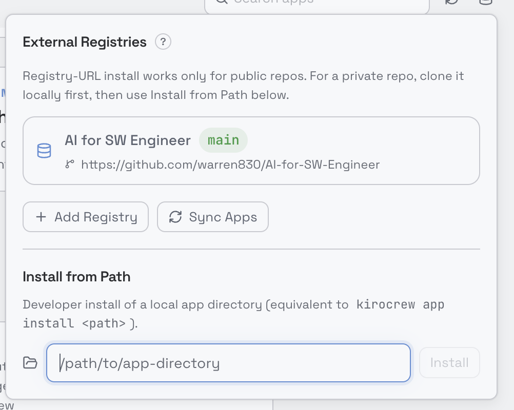

3. 打开 **Library**，找到 **AI-DLC Studio**，点击 **Enable**。列表里没有时，检查是否开启了
   **Show enabled only**。启用后，**⋯** 菜单里还有 **Sync**（更新时使用）、**Disable** 和 **Uninstall**。

   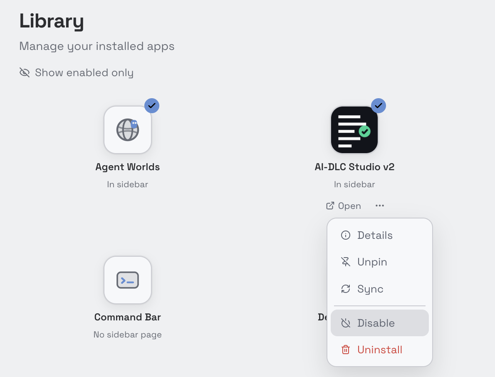

4. 如果 KiroCrew 打开应用详情并要求授予信任，只为这个应用授予即可，无需开启第三方应用的全局信任。
5. 启用后，**AI-DLC Studio** 会出现在侧栏，也可以在 **Library → Open** 打开。

路径必须是 Gateway 所在机器上的目录。已经装了 1.x 时，KiroCrew 会拒绝再装一个同名应用，请按
[从 1.x 更新](#updating-from-1x) 更新它。

### 方式二：添加 GitHub registry（装的是 1.x，不是 v2）

本仓库本身也是一个应用 registry，但 `app-registry.json` 指向 `release` 分支，也就是 1.x 版
**AI-DLC Studio**（`aidlc-studio`）。如需用这种方式安装 1.x：在 **Discover → Add source → Add Registry** 添加
`https://github.com/warren830/kirocrew-app-aidlc`，分支填 `release`，然后在 **Discover → AI-DLC Studio →
Install**。Gateway 会自己克隆 registry，不继承终端里的代理变量，所以它需要能直接访问 GitHub。

<a id="updating-from-1x"></a>

### 从 1.x 更新

2.0.0 沿用 1.x 的名字 `aidlc-studio`，所以是原地替换 1.x，而不是装在它旁边。它需要 KiroCrew 0.11.0
或更新版本，请先升级 KiroCrew。然后按当初的安装方式更新 Studio：

- **从文件夹安装的：** 把克隆目录切到 `v2` 分支再同步。

  ```bash
  git fetch origin
  git checkout -B v2 origin/v2
  ```

  然后 **Library → AI-DLC Studio → ⋯ → Sync**。
- **从 Discover 安装的：** 等这个来源列出 2.0.0 后，接受 KiroCrew 为 AI-DLC Studio 提供的更新。

2.0.0 第一次启动时会迁移 Studio 的数据库。活动记录、安装凭据、安装事务和设置都会保留，所以 1.x 装过
AI-DLC 的仓库照旧可以在 2.0.0 里升级和卸载。2.0.0 不再读取的几张表会被删除。因为 2.0.0 内置了更新的
AI-DLC，这些仓库随后会在仓库页显示 **有可用升级**，可以按需逐个升级。

如果你从文件夹装过 2.0.0 测试版 **AI-DLC Studio v2**（`aidlc-studio-v2`），它仍是另一个应用，用自己的
数据库，2.0.0 不会合并它的数据。这个文件夹现在的清单名是 `aidlc-studio`，KiroCrew 会拒绝用它同步那个应用。
它装过 AI-DLC 的仓库，安装凭据在它自己的存储里，请在它里面升级或卸载。不要用两个 Studio 操作同一个仓库，
因为两个 Studio 会各自为同一个意图开会话。

<a id="step-2"></a>

## 第 2 步：检查安装结果

打开 **AI-DLC Studio → 设置**，滚动到 **关于**。

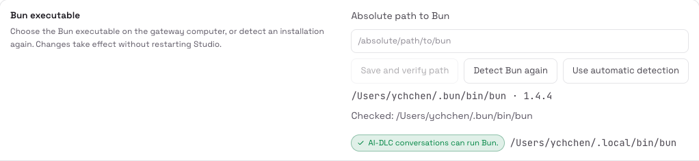

1. **Bun 可执行文件** 应显示 Bun 的路径和版本，例如 `/Users/you/.bun/bin/bun · 1.4.4`。如果没有路径，只有
   **已检查：** 后面列出的查找位置，说明没找到 Bun：
   - 点击 **重新探测 Bun**；
   - 仍未找到时，在 Gateway 机器上运行 `command -v bun`，把输出的完整路径填入 **Bun 的绝对路径**，点击
     **保存并校验路径**。要填展开后的路径，不能写字面的 `~` 或 `$HOME`。**使用自动探测** 可恢复自动查找。

   从桌面版启动的 Gateway，`PATH` 与终端不同，所以终端里能用的 Bun 在这里仍可能找不到。Studio 依次查找：
   Gateway 的 `PATH`、`~/.bun/bin/bun`、`/opt/homebrew/bin/bun`、`/usr/local/bin/bun`、
   `/home/linuxbrew/.linuxbrew/bin/bun`。修改立即生效，无需重启 Studio。
2. 同一行还必须显示 **AI-DLC 对话可以运行 Bun。** 如果显示 **AI-DLC 对话无法运行 Bun。**，点击
   **让对话可以使用 Bun**，再点 **创建链接**。Studio 只会创建一个符号链接 `~/.local/bin/bun`（每个会话的
   `PATH` 都已包含该目录），不改动其他任何东西；删除这个链接即可撤销。用官方脚本安装 Bun、又从桌面版启动
   Gateway 时，通常都需要这一步；跳过的话，AI-DLC 会拒绝你的每一个决定。
3. **状态** 应为 **健康**，**内置载荷** 显示文件已校验，**工具** 里 `bun` 和 `git` 都带版本号。

也可以在终端里只读地检查同样的健康状态：

```bash
bash scripts/kcapi.sh GET /api/apps/aidlc-studio/health
```

<a id="tour"></a>

## 界面导览

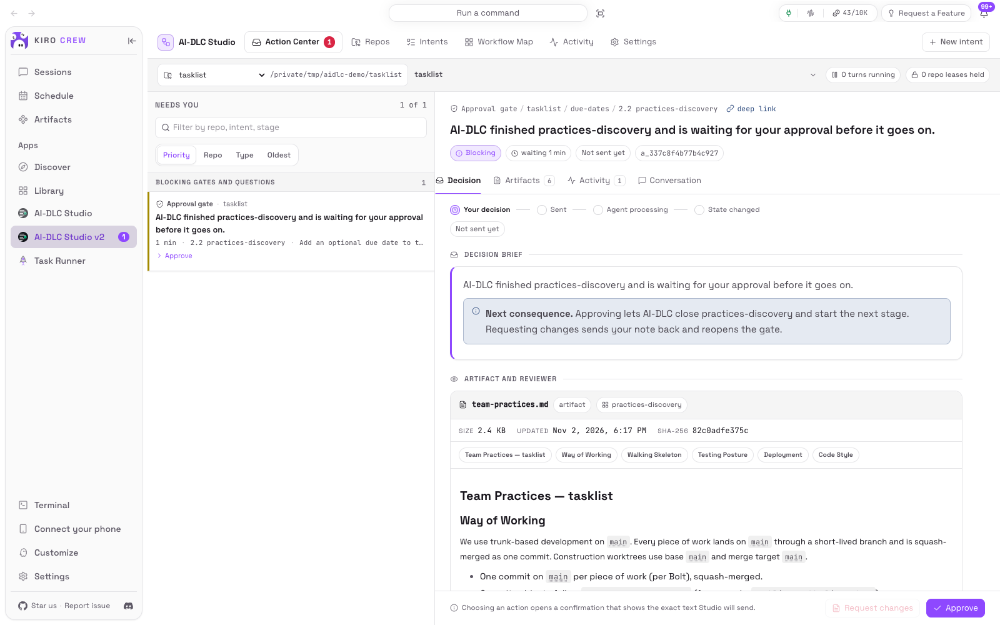

- **顶栏**：**待办中心**（带待你处理的数量）、**仓库**、**意图**、**流程图**、**活动**、**设置**，右侧是
  **新建意图**。
- **范围栏**（顶栏下方）：选择 **全部仓库** 或某一个仓库；在只读一个意图的页面上，还要选意图。每个页面都按这里的范围显示。
- **执行状态**（范围栏右侧）：正在运行的回合、持有的仓库租约、待恢复的决定和告警。显示 **正在轮询更新**
  表示实时事件流没连上，Studio 改为定时重读：不会漏掉任何东西，只是更新慢一些。
- **横幅**：环境降级时显示（带 **打开设置**）；控制台会话过期时提示重新加载页面（没有任何内容被发送）。
- **通知**：KiroCrew 侧栏上的计数，以及可选的 Slack 消息，见 [通知](#notifications)。

界面支持英文和简体中文，默认跟随仪表盘语言，并支持浅色和深色主题。AI-DLC 自己的文字（阶段名、问题、产物、
评审发现、审计字段）从不翻译。

<a id="first-intent"></a>

## 从零跑完第一个意图

### 1. 登记仓库

1. **仓库 → 添加仓库**。
2. 点击 **浏览目录** 选择项目，再点 **使用此目录**；或直接填写 **绝对路径**（开头的 `~` 会被展开）。
   **标签（可选）** 是它在队列和范围栏中显示的名字，留空则用目录名。
3. 点击 **运行预检**。只读预检会显示解析后的路径和身份、Git 状态、Bun 的版本和路径、已有的引擎文件、磁盘上
   AI-DLC 的版本和状态布局、剩余空间、写权限，以及各项警告。Studio 不会在目录里执行任何东西，也不写入任何内容。
4. 看到 **该路径可以注册。** 后，点击 **注册该路径**。

同一个仓库换个路径再登记会被拒绝（**已经注册过**），因为 Studio 的租约是按仓库身份加的。

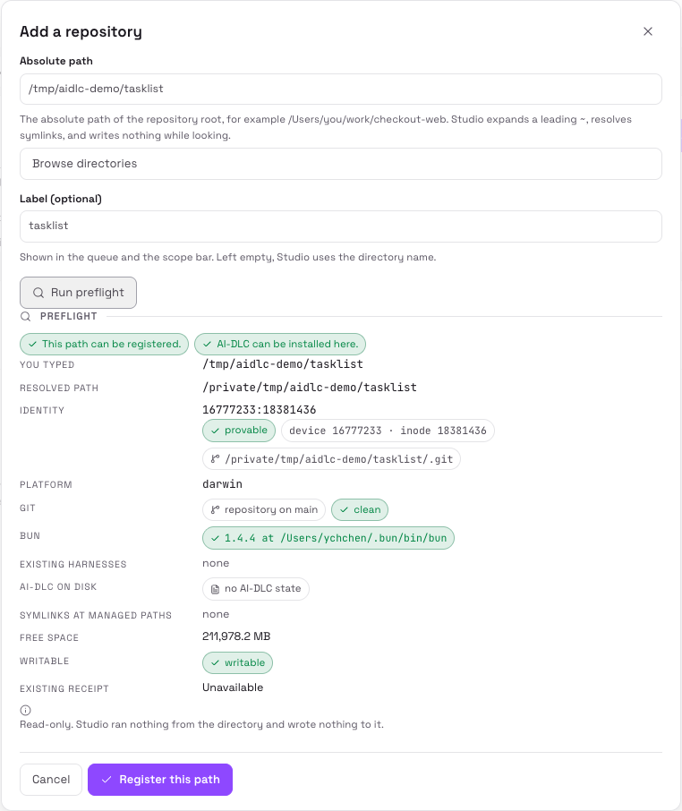

### 2. 给仓库安装 AI-DLC

打开该仓库（**详情**），点击 **安装 AI-DLC**。**安装预览** 会列出每一个受管路径、归谁所有、会发生什么。此时还没有写入任何东西。

- 框架自己的文件会被创建，并连同摘要记入 **安装凭据**。
- 你的 `.kiro/settings/*.json` 是合并目标：Studio 只添加并管理自己的那一段，其余内容（包括密钥）原样保留。
- 已有的 `aidlc/` 工作区原样保留。
- Studio 不写 `AGENTS.md` 和 `.gitignore`；创建第一个意图时，AI-DLC 会在这两个文件里加上它自己带标记的段落。
- **阻止本次操作的冲突** 列出受管路径上与 Studio 将要安装的内容不同的文件，并附差异。没有强制覆盖选项：请自己把文件挪开，或者保持仓库现状。

点击 **安装 AI-DLC 2.11.3** 确认。事务抽屉会显示每一步：获取管理租约、暂存并校验载荷、备份、写入、合并片段、
校验、提交凭据。失败会恢复到开始前的状态。如果你看预览期间仓库发生了变化，不会写入任何内容，预览会重新读取，请再核对一遍。

### 3. 新建意图

点击 **新建意图**。向导共四步，点 **创建** 之前不会写入任何东西。

1. **工作**
   - **仓库**：只能选已登记且已安装 AI-DLC 的仓库。
   - **空间**：AI-DLC 只在当前活动空间里创建意图。要换活动空间，到仓库页面操作（见 [空间](#spaces)）。
   - **目标**：一句话，引擎把它当作这个意图的输入。请以文字开头：开头的 `-` 会被当成选项。
   - **引擎需要知道的背景**：可选，发送时接在目标后面。计数器显示两者合计可用的字符数；长文档请在意图创建后再附加。
   - **标签**：最多三个小写英文单词，用连字符连接，例如 `guest-checkout`。它会成为意图的目录名，之后不能改名。
     留空时由 AI-DLC 根据目标生成。
   - **项目类型**：可选，帮助引擎判断条件阶段是否适用。
2. **预设**
   - **范围**：决定 AI-DLC 的哪些阶段可选。列表从仓库读取，也包括项目自己定义的范围。
   - **深度**：最简（每个阶段一遍、提问少）、标准（需要你输入时才问）、全面（提问更多、产物更详细）。
   - **评审上限**：任何阶段可用的最强评审。none（无评审，关卡仍要你批准）、advisory（只给意见，不阻塞）、
     adversarial（关卡通过之前必须回应评审发现）。
   - **测试策略**：最简（冒烟）、标准（单元加集成）、全面（另加性能验证）。
   - **让顾问推荐这些设置**：读取你的目标和仓库，推荐以上全部设置。**采用这份建议** 会填入各字段，你仍可逐项修改。
3. **计划**：列出 AI-DLC 已知的全部阶段（分五个阶段组），以及每个阶段产出和依赖什么。可逐个开关。不能改的阶段会
   写明原因（总是执行、被其他阶段依赖、已完成等）。组合破坏了依赖时，**AI-DLC 不接受这个计划的原因** 会说明缺什么。
   计划差异显示你相对预设改了什么，以及对下游的影响。
4. **复核**：来自已安装阶段图的精确阶段数、关卡数、产物数，带来源和置信度的估算，计划声明的产物，以及计划指纹。
   如果阶段图或范围在预览后变了，AI-DLC 会拒绝创建，而不是创建一个你没看过的计划。

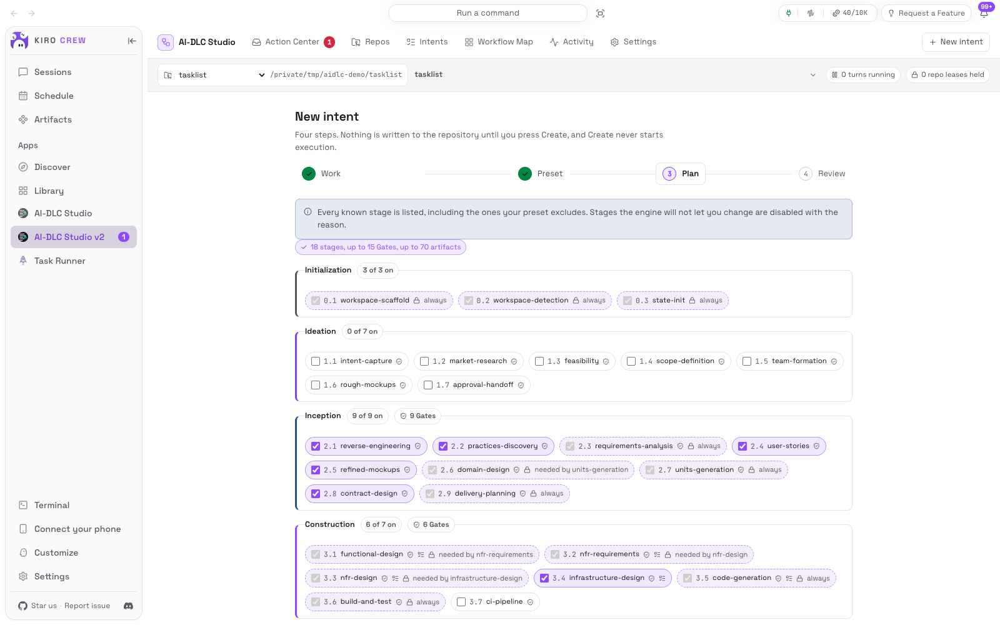

点击 **创建意图（保持暂停）**。AI-DLC 写入意图记录并编译运行图，**不会运行任何工作流回合**。如果创建后编译失败，
在同一个意图上点 **重试编译运行图**，不要再新建一个。

### 4. 绑定会话并开始运行

打开 **意图** 页（向导会给出链接）。新意图还没有会话，所以它那一行最前面是 **绑定会话**。没有会话之前，这个意图的任何决定都会被拒绝。

会话面板显示仓库、项目和 agent（`aidlc`），并提供：

- **创建会话并继续运行（发送 `/aidlc`）**：创建 KiroCrew 会话、命名、指向这个仓库、切换到 `aidlc` agent、绑定到该意图、
  放进侧栏中该仓库的文件夹，然后发送一次 `/aidlc`。按钮写“继续”，是因为创建意图时 AI-DLC 已经完成了初始化阶段；还没有任何阶段完成的意图上，它写作“开始运行”。
- **只创建并绑定，不运行**：同上，但不发送任何内容。
- **绑定已有会话**：列出已在这个仓库上打开、使用 `aidlc` agent 的会话；其他会话一律不接受。

绑定会话后，点 **运行到下一个检查点**，确认后发送 `/aidlc`。AI-DLC 会一直运行，直到遇到需要你处理的事、失败或完成。
它从不自己越过检查点继续跑。

### 5. 在待办中心处理检查点

AI-DLC 停下来等你时，待办中心会出现一张卡片，同时收到通知。

1. 选中卡片，在 **决定**、**产物**、**评审**、**活动**、**会话** 几个标签页查看证据。
2. 做出选择：关卡选 **批准** 或 **要求修改**（附说明）；提问则填写表单后点 **发送答案**。
3. 确认框会显示你点的按钮和将要发出的原文，例如 `按钮：批准 → 发送：…`。点击 **确认，发送这段原文**。
4. 投递进度条会跟踪它：**等你决定 → 已发送 → 智能体处理中 → 状态已变更**。只有 AI-DLC 的审计记录和状态文件表明它确实处理了你的决定，
   卡片才会消失；接口返回成功不算数。

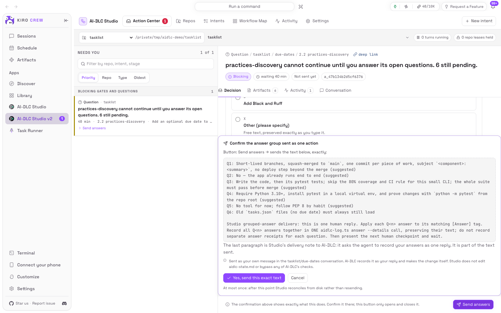

AI-DLC 接受你的决定后会自己运行到下一个检查点。重复这一步，直到工作流完成。

### 6. 跟踪进度

- **意图** 页：每个意图的状态、当前阶段和进度。
- **流程图**：按阶段泳道画出计划和每个阶段的实时状态。
- **活动**：所有发生过的事的时间线，并标明来源。

### 7. 完成与提交

Studio 从不执行 Git 写操作。意图完成后，它在意图页那一行会出现 **准备提交**，让该意图的会话提交工作流所做的改动，
但不推送。发出前你会先确认具体请求。之后可在 **仓库 → Git 观测** 查看结果。

<a id="action-center"></a>

## 待办中心

### 队列

**等你决定** 列出当前范围内所有已登记仓库的卡片。可按 **优先级**（默认）、**仓库**、**类型**、**最久** 组织，设置会记住你的选择。
按优先级时分组顺序为：

1. 需要恢复处理，以及投递结果不确定
2. 阻塞中的关卡与提问
3. 熔断、失败与安装冲突
4. 请求、预算停止与暂停

同组内最早的排在前面。**按仓库、意图、阶段筛选** 可缩小列表。队列为空时显示“没有需要你判断的事”。

### 卡片类型

| 卡片 | 含义 | 你可以做什么 |
|---|---|---|
| 审批关卡 | 某阶段已完成，等你批准 | **批准**、**要求修改**；**按现状接受** 只在引擎提供后才出现 |
| 提问 | 阶段要等你回答才能继续 | **发送答案**；部分检查点为 **确认摘要**、**接受这些假设** 或 **转成追问** |
| 计划批准 | 阶段等你批准它的计划 | **批准计划**、**要求修改计划** |
| 缺少输入 | AI-DLC 开始前需要你提供东西，或在会话里问了你问题 | **发送补充输入**；空间没有活动意图时为 **设为当前活动意图** |
| 修订中 | 阶段正按你的意见修订 | 仅提示 |
| 恢复 | 证据互相矛盾，或绑定的会话找不到了 | **重新绑定会话**、**记录为从未发送**、**确认已知悉** |
| 送达状态未知 | Studio 无法证明你上一个决定是否送达 | **依据磁盘对账**、**记录为从未发送**、**再次发送** |
| 失败 | 引擎在某阶段失败 | **立即重试**、**保持暂停** |
| 连续失败 | 同类失败多次后已停止派发 | **立即重试**、**保持暂停** |
| 安装冲突 | 某个 Studio 管理的文件与安装时不一致 | 跳转到该仓库页面处理 |
| 预算停止 | 预算在下一回合前停住了意图 | **立即运行**、**保持暂停** |
| 运行、继续、准备提交 | 你发起但没发出去的命令 | 在卡片上重新发送 |

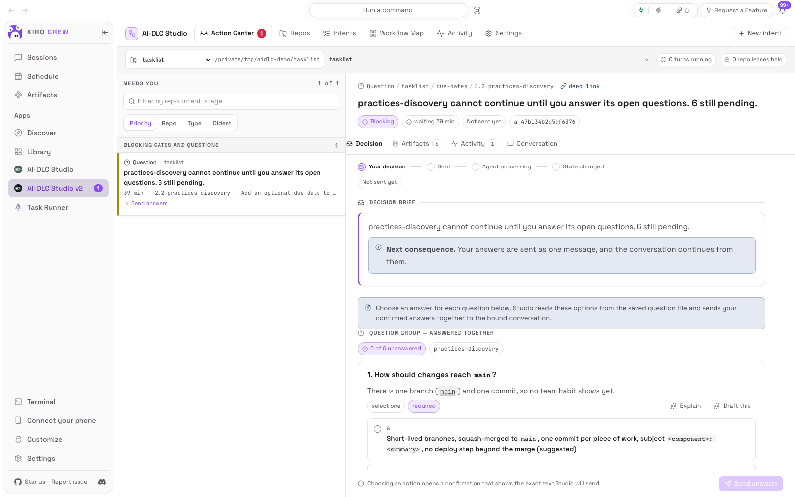

### 决定详情

- **决定**：标题、每个选项的后果，以及操作按钮。关卡还会列出该阶段的验收标准和未解决的风险。
- **产物**：该阶段产出的文件、历次修订及其差异。Studio 只读不改；**要求修改** 是让 AI 去修订。
- **评审**：评审约定、评审发现（按未解决阻塞、建议、已回应分组）以及 AI-DLC 的评审记录。发现内容原文引用。
- **活动**：这个意图的事件。
- **会话**：该意图会话本身的记录。你在那里输入的任何内容都算你的回合。

**深链** 可复制一个重新打开这个决定的链接。

### 投递状态

| 状态 | 含义 |
|---|---|
| 尚未发送 | 已记录，还没发 |
| 发送中 | 正在送往会话 |
| 已发送 | 会话已收到 |
| 处理中 | AI-DLC 正在处理 |
| 已生效 | AI-DLC 已记录，工作流已推进 |
| 已答复 | AI-DLC 已记录，但没有发生流程迁移 |
| 未发送 | 已证明从未到达会话 |
| 需要核对 | 已送达或可能已送达，结果尚未证实 |
| 失败、已取消 | 结束且没有产生效果 |

每个决定最多送达一次。会话正忙或仓库被其他操作占用时，不会发送任何内容，卡片会写明原因，等空闲后再发即可。
如果你做决定期间证据变了，Studio 会显示刷新后的证据，请你重新确认。

<a id="delivery-uncertain"></a>

### 送达状态未知时

Studio 从不自动重发，它会持续读取 AI-DLC 的文件等结果。你可以：

- **依据磁盘对账**：立即重读文件和会话；
- **记录为从未发送**：Studio 先核对自己的证据，证明不了就拒绝；
- **再次发送**：确认你已读过投递证据后，把这个决定作为新事项重新排队。若能证明第一次已送达，Studio 会拒绝。

### AI 顾问

顾问是可选的只读助手，运行在独立会话中。它不能写文件、不能执行命令、不能推进工作流，也不能以你的身份回复 AI-DLC；
它的活动只记录在 Studio 的活动页，从不写进 AI-DLC 的审计记录。

- 关卡上：**咨询顾问**（**分析这项决策**、**起草修改要求说明**）。返回解读、证据、假设、备选方案和置信度。
  **把草稿填入说明框** 会把草稿填进说明框，供你修改。
- 提问上：**起草全部答案**、**起草本题** 或 **解释**。**套用草稿中的选择** 会填好表单；“批准”从不会被预先选中。
- 失败和恢复上：**用 AI 诊断**。

起草一次大约需要三分钟。想在打开卡片时草稿已经备好，可在 **设置 → 顾问 → 按仓库提前起草** 里勾选仓库；
这会在每张卡片上消耗模型用量，所以默认关闭。

### 工具授权

会话在等你批准某个工具调用时，意图页那一行会提示，同时收到通知。请在会话里选择允许、信任或拒绝：点 **打开会话**。

<a id="intents"></a>

## 意图

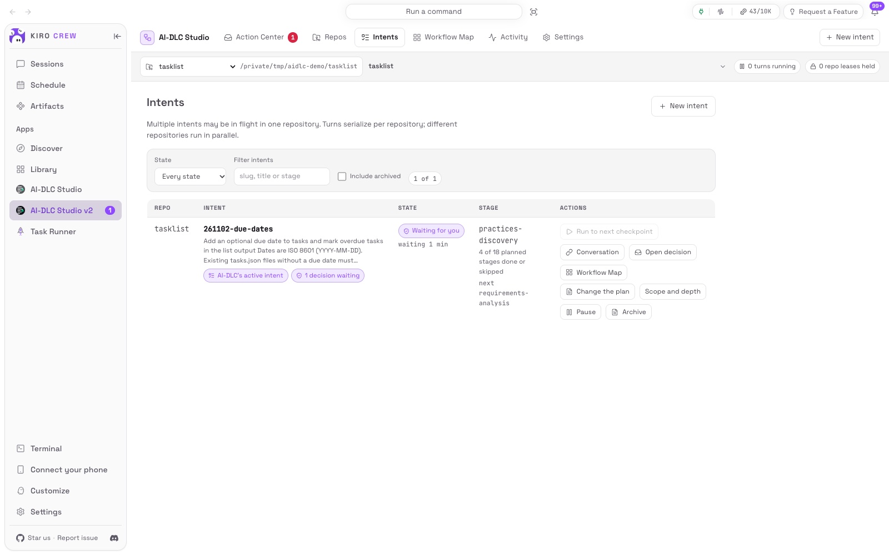

当前范围内每个意图一行，显示仓库、状态、当前和下一个阶段、进度（如“33 个阶段中已完成或跳过 3 个”）、待处理的决定和评审发现。
标签分别标出 **AI-DLC 的当前意图**、**已暂停**、**已归档**。可按 **状态**、**空间** 或文字筛选，勾选 **包含已归档** 查看已归档意图。
一个仓库里可以同时有多个意图在进行：同一仓库内的回合依次执行，不同仓库可以并行。

| 按钮 | 作用 |
|---|---|
| **绑定会话** / **会话** | 打开会话面板：创建、绑定、**改绑到另一个会话**、**解除绑定**、**在 KiroCrew 中打开** |
| **运行到下一个检查点** | 确认后发送一次 `/aidlc`；有回合在跑、有检查点待处理或已完成时不可用 |
| **继续** | 发送 `/aidlc --resume`；只对 AI-DLC 搁置的意图提供 |
| **打开决策** | 在待办中心打开该意图待处理的卡片 |
| **流程图** | 打开该意图的流程图 |
| **调整计划** | 通过 AI-DLC 自己的 recompose 命令开关 AI-DLC 游标之后尚未开始的阶段；不发送消息 |
| **范围与深度** | 预览并应用新的范围、深度或测试策略。已完成的阶段保留其历史 |
| **暂停** / **当前回合结束后暂停** | 让 Studio 不再为该意图发送任何内容；正在运行的回合会跑完。暂停期间待处理的决定无法发送 |
| **重新允许派发** | 结束暂停；不发送任何内容 |
| **归档** / **恢复** | 只在 Studio 里把意图从默认视图隐藏，不改任何 AI-DLC 文件。有待处理决定的意图会先被暂停 |
| **准备提交** | 意图完成后出现：让会话提交改动，不推送 |

上一轮因 KiroCrew 报错停下时，那一行会提示。AI-DLC 会保留已写入的内容；排除原因后，点 **运行到下一个检查点** 即可从那里接着跑。

解除绑定只是让意图忘记用哪个会话，会话本身和所有 AI-DLC 文件都不变。某个决定可能仍在投递途中时，不允许改绑。

<a id="workflow-map"></a>

## 流程图

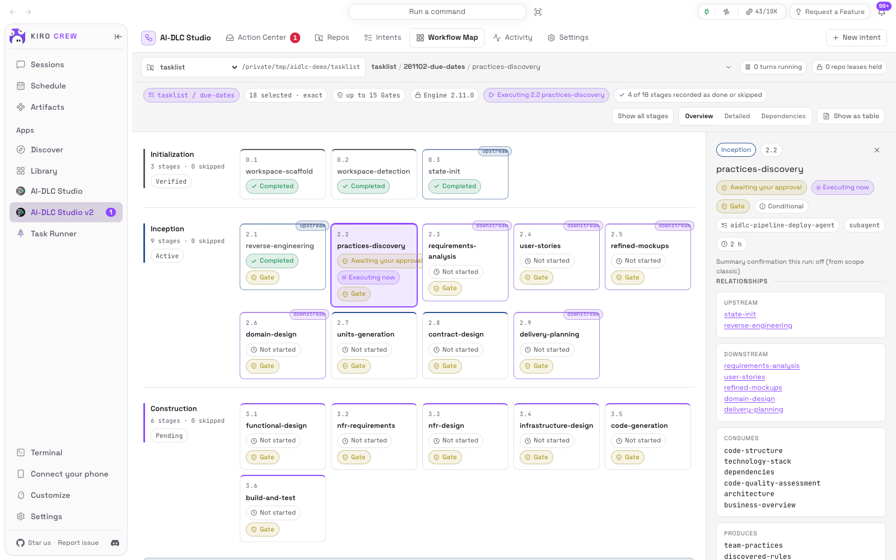

流程图针对一个意图（在范围栏里选），按 AI-DLC 的五个阶段组画泳道：Initialization、Ideation、Inception、
Construction、Operation。每张阶段卡显示状态、主 agent、关卡、评审级别、耗时和文件；**正在执行** 标出当前阶段。

- **查看所有阶段**：把本计划排除的阶段也画出来，并写明原因；阶段编号始终不变。**只看当前计划** 回到计划视图。
- **信息密度**：**概览**、**详细**、**依赖**（画出上下游连线）。
- **展开单元子泳道**：把 Construction 按工作单元拆成多条泳道。
- **以表格显示**：改为列表显示可见阶段。

点选一个阶段会打开 **阶段检视**：它为什么在执行或没在执行、依赖和产出什么、它的文件（点击打开）、评审约定和发现、
最近的审计事件，以及它允许的那一个 **可执行的操作**（例如在待办中心打开它的关卡）。窄屏上各阶段组会变成折叠面板。

<a id="activity"></a>

## 活动

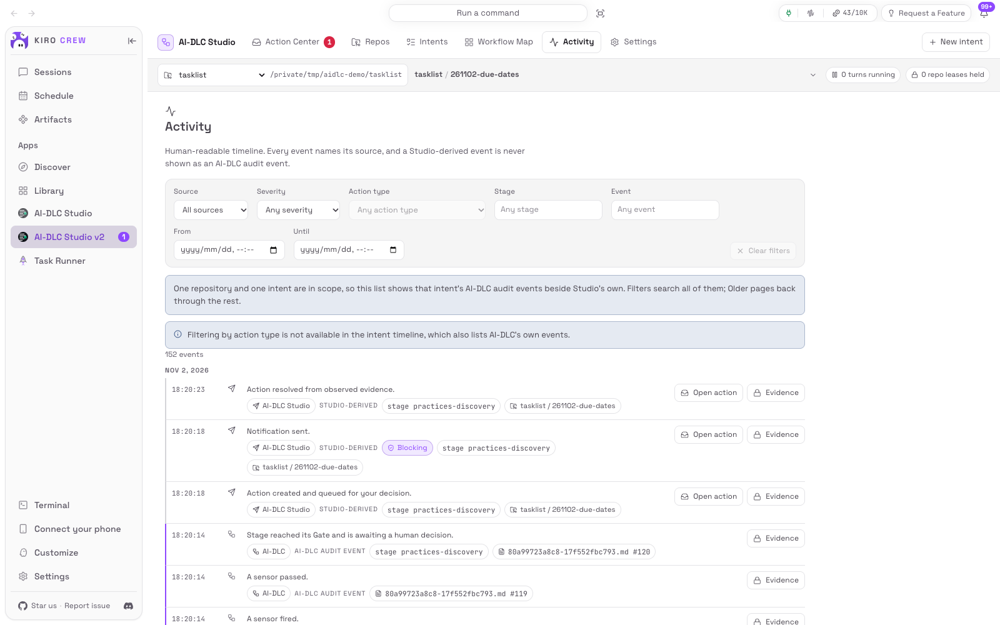

一条可读的时间线。每一行都标明来源：**AI-DLC**、**KiroCrew**、**Git** 或 **AI-DLC Studio**；Studio 推导出的事件从不冒充 AI-DLC 的审计事件。

- 范围为 **全部仓库** 时，只显示 Studio 自己的记录。在范围栏选定一个仓库和一个意图后，会同时显示该意图的 AI-DLC 审计事件。
- 可按 **来源**、阶段、事件、操作类型、严重程度和时间范围筛选；**更早**、**更近** 用于翻页。
- 点某行的 **证据** 打开 **证据抽屉**：来源说明、原始审计块（**复制原始块**）、文件位置和记录的值。凭据会被去除，
  已登记仓库之外的路径不会显示。
- **诊断导出**：生成一个可下载的包，含健康状态、版本、设置、仓库、操作、租约、事务和近期活动，用于报告问题。
  导出会去除凭据、脱敏路径、不含产物内容；除非先在设置里允许，否则也不包含你发送过的文字。

<a id="repos"></a>

## 仓库

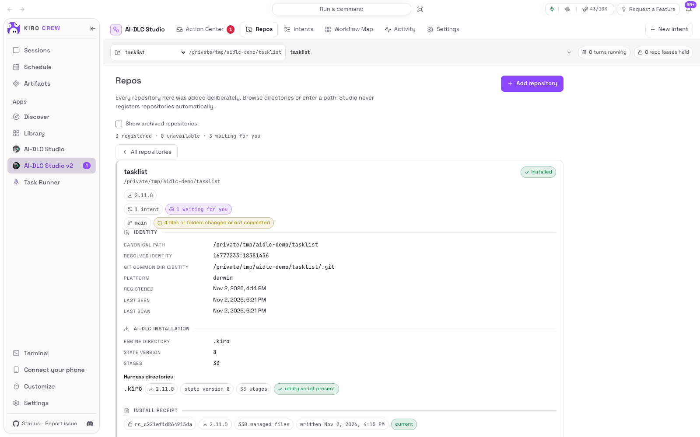

列表显示每个已登记仓库的 AI-DLC 状态、引擎版本、Git 状态、意图数和待办数。勾选 **显示已归档仓库** 可看到已归档的。点开某个仓库查看详情。

### 可用性

仓库无法读取时，页面会写明原因和处理方法：

| 显示 | 处理 |
|---|---|
| 已移动 | **重新绑定到新路径**：意图、操作和历史都会保留 |
| 无访问权限 | 恢复读权限后 **重新扫描** |
| 不可用 | 恢复后 **重新扫描**，或 **取消注册** |
| 无法确认身份 | 处理重复的目录；在此之前执行和安装都被禁用 |

### AI-DLC 安装与维护

下面每个操作都先预览，确认后才写入，并持有独占的管理租约（会等正在运行的回合结束，从不打断它），失败时恢复到开始前的状态。

| 按钮 | 何时出现 | 作用 |
|---|---|---|
| **安装 AI-DLC** | 未安装 | 安装内置引擎文件并生成凭据 |
| **升级 AI-DLC** | **有可用升级** | 升级到内置版本。你改过的文件会阻止升级并显示差异；要淘汰的文件只在未被修改时才删除 |
| **更新 AI-DLC 文件** | **有更新的文件** | 应用同一版本的较新文件 |
| **恢复 AI-DLC 文件** | **安装后被修改** | 重建缺失的文件，重写 Studio 可以替换的文件。你改过的文件会阻止恢复，直到你处理 |
| **回退引擎版本** | 升级之后 | 从备份恢复紧邻的上一个兼容引擎版本 |
| **卸载引擎** | 已安装 | 删除凭据所记录的文件和片段。工作流数据、项目文件、改过的配置文件保留并列出 |
| **安装恢复** | **需要恢复安装** | 清理一次没完成的回滚，有独立的预览和校验。清理之前该仓库无法运行 AI-DLC |
| **运行 AI-DLC doctor** | 随时 | AI-DLC 自己的健康检查。它会在审计记录里加两条，所以只在你要求时运行 |

安装进行中可点 **取消安装并回滚**：等当前文件操作完成后恢复备份。**安装历史** 列出每次事务，点开可看每一步。

已安装的 AI-DLC 比 Studio 内置的更新时，Studio 不会覆盖安装；仓库的 AI-DLC 状态版本无法证明可以安全迁移时，Studio 也不会写入。
两种情况都会显示出来，仓库保持可读。

### Git 观测

显示分支、HEAD、上游、领先/落后，以及改动的文件，分为三类：凭据所有且有本地改动的文件（会阻止升级）、意图写入但尚未提交的代码、其他改动。
Studio 只读 Git：从不提交、推送、检出、stash 或 reset。

<a id="spaces"></a>

### 空间

显示当前活动空间。**新建空间** 会创建一个新空间，团队记忆从默认空间复制初始化，活动空间不变。**切换空间** 会改变仓库的活动空间；有回合在运行时不能切换。

### 清理事务文件

列出事务在仓库外留下的备份和失败尝试目录，含大小和保护状态。选中旧目录，点 **预览选中的清理项**，再点 **删除已核对的目录**。
当前安装、进行中的事务或恢复所需的目录受保护。删除较旧的备份会失去对应的回退点。

### 重命名、归档、取消注册

**重命名仓库** 修改标签。**归档仓库** 把它从活动列表隐藏，保留文件、绑定和历史，可在 **显示已归档仓库** 中恢复。
**取消注册** 会忘掉这个登记、它的绑定和操作。这些操作都不会改动仓库里的任何字节。

<a id="settings"></a>

## 设置

这里都是 Studio 自己的偏好设置，不会改动任何 AI-DLC 文件。

| 分区 | 设置项 |
|---|---|
| 语言与显示 | **界面语言**（跟随仪表盘、English、简体中文）；**密度**（紧凑、宽松） |
| 操作队列 | **队列排序方式**：优先级、仓库、操作类型、最早优先 |
| 自动化与预算 | **全局并发**：同时可以有几个仓库在运行回合（每个仓库内始终一次一个）；**在安装或升级后运行 doctor** |
| 顾问 | **在决策处提供顾问**；**按仓库提前起草**；顾问模型（由 KiroCrew 分配） |
| 通知 | **发送 Slack 通知** 与 **已静音的仓库**；**显示仪表盘通知** |
| 诊断 | 活动记录保留天数；**允许在诊断导出中包含提示正文**（默认关闭）；你发送的文字保留天数（1 到 30 天） |
| 关于 | **Bun 可执行文件**；Studio 版本与内置 AI-DLC 版本；最低及当前 KiroCrew 版本；平台；状态；载荷、工具、存储和协调器的健康状况 |

<a id="notifications"></a>

### 通知

新的关卡、提问、失败、送达状态未知、工具授权和完成，都会产生仪表盘通知。KiroCrew 配置了 Slack 时，Slack 消息会发到所有者的私信，
只包含阻塞类事件。Slack 消息会链接回 Studio，在这里做决定：KiroCrew 无法把 Slack 按钮点击作为经过验证的决定传回 Studio。

### 无人值守运行

Studio 没有无人值守模式。对 AI-DLC 来说，任何往会话里发文字的方式都算一次人工回合，所以 Studio 会在每个检查点停下，只发送你确认过的内容。

<a id="mobile"></a>

## 在手机上使用

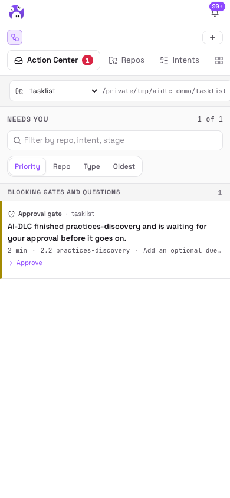 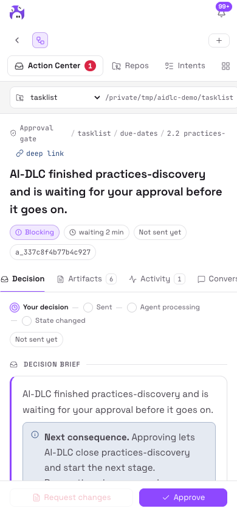

待办中心队列和决定详情在 390px 宽度下可用，可以在手机上查看证据并做决定。登记仓库，以及安装、升级或恢复 AI-DLC，只能在桌面上操作。

<a id="update"></a>

## 更新、重新构建或卸载 Studio

### 更新

请在没有 Studio 操作进行时更新。先在克隆目录里拉取新代码：

```bash
git pull --ff-only
```

然后 **Library → AI-DLC Studio → ⋯ → Sync**，KiroCrew 会从原目录重新同步并重新加载后端。

新版 Studio 可能内置更新的 AI-DLC，这时仓库页会显示 **有可用升级**，可以按需逐个升级。

### 重新构建 UI

只有修改了 UI 源码才需要。仓库锁定的 Vite 依赖要求 Node.js `^20.19.0 || >=22.12.0`：

```bash
(cd ui && npm ci && npm run build)   # 构建 ui/dist/index.mjs
```

然后 **Library → AI-DLC Studio → ⋯ → Sync**。

### 卸载

如果也想把 AI-DLC 从仓库中移除，请先在 **仓库 → 卸载引擎** 中操作：安全卸载所依赖的安装凭据保存在 Studio 自己的存储里。
然后再 **Library → AI-DLC Studio → ⋯ → Uninstall**。

<a id="troubleshooting"></a>

## 常见问题

| 现象 | 处理方法 |
|---|---|
| 终端提示 `bun: command not found` | 按 [第 0 步](#step-0) 安装并配置 `PATH`，重新打开终端后运行 `bun --version` |
| Windows 上 PowerShell 里能运行 Bun，Studio 却找不到 | Studio 运行在 WSL 里，要在 Ubuntu 终端里按 [第 0 步](#step-0) 再装一次 Bun |
| 终端能运行 Bun，Studio 却显示未找到 | 在 Gateway 机器上运行 `command -v bun`，把输出填入 **设置 → 关于 → Bun 的绝对路径**，点 **保存并校验路径** |
| 显示 **AI-DLC 对话无法运行 Bun**，或所有批准都被拒绝 | **让对话可以使用 Bun → 创建链接** |
| 提示“~/.local/bin 不在本 gateway 的对话 PATH 里” | 把 Bun 所在目录加入 KiroCrew 的 agent 环境（`agent.env` 的 `PATH`），然后重启 Gateway |
| Install from Path 提示 `source is not a directory` | 填写 Gateway 机器上克隆目录的绝对路径（在克隆目录中运行 `pwd`） |
| 在 Library 点 Enable 后跳到应用详情 | 在详情中为 AI-DLC Studio 授予信任；必要时再点一次 **Enable** |
| **新建意图** 里选不了某个仓库 | 到仓库页给它安装 AI-DLC，或完成安装恢复 |
| 决定被拒绝：“该意图尚未绑定会话” | **意图 → 绑定会话** |
| 提示“另一操作正占用该仓库” | 等安装、doctor 或回合结束后重新发送。没有任何内容被发出 |
| 提示“你决定期间情况已变化” | 查看刷新后的证据并重新确认 |
| 提示“AI-DLC 的文件互相矛盾” | 打开恢复卡片按提示处理；文件一致之前不会发送任何内容 |
| 提示“AI-DLC 当前的活动意图与该决定不符” | Studio 能切换时会自动切换；否则在卡片上点 **设为当前活动意图** |
| **送达状态未知** | 见 [送达状态未知时](#delivery-uncertain)。Studio 从不自动重发 |
| 上一轮因错误停下 | 在 KiroCrew 中排除原因（会话会给出处理方式），然后点 **运行到下一个检查点** |
| 页面能打开，但项目里跑不了 AI-DLC | 按 [第 2 步](#step-2) 检查，确认 `kiro-cli` 已登录，且已给该仓库安装 AI-DLC |
| 提示“控制台会话已过期” | 重新加载页面。没有任何内容被发出 |

寻求帮助时，请附上活动页生成的 **诊断导出**。

## 延伸阅读

- [README](../README.zh-CN.md)：Studio 为什么存在、一个决定如何送达 AI-DLC、Studio 刻意不做的事。权限说明和开发方式见
  [英文 README](../README.md)。
- [架构](design/architecture.md) 与 [契约](design/contracts.md)：实现方式。
- [Docker 安装验证记录](verification/2026-09-17-docker-install/README.md)：在官方 KiroCrew 镜像（Linux ARM64）中的一次实际安装。
